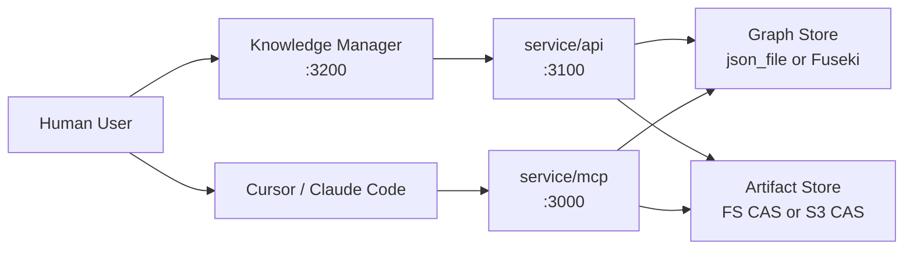

# Signet Demo

This is the human-facing demo guide for **Signet** — the seal of approval for agents and skills.

For the broader value proposition and future killer-app directions, see:
- `docs/quick-value-roadmap.md`

It describes the real first-user path we validated locally:
- start the stack with Docker Compose
- seed the demo content with `registry-operator`
- connect a human MCP client to `service/mcp`
- discover and load the demo agent and skills
- log into the browser admin surface
- drive the governance flow: validate, review, publish, certify, verify, and replay provenance

## What this demo seeds

The blessed demo pack creates:
- one demo agent: `cursor:registry-agent`
- one MCP usage skill: `skill:registry-mcp`
- one fun proof skill: `skill:tame-llama`

The intended story is:
1. a human MCP client discovers the demo agent
2. the client loads the linked skills
3. the human browser admin surface shows the same registry content
4. the operator then walks the trust story: multi-layer validation, human review, signed publication, certification, and cryptographic verification

## Prerequisites

- Docker Desktop or equivalent local Docker runtime
- Node.js 20+
- Cursor, Claude Code, or another MCP-capable client

## 1. Start the stack

```bash
cd signet/infra
make up
```

Verify:

```bash
curl -s http://localhost:3000/healthz
curl -s http://localhost:3100/healthz
curl -s http://localhost:3200/healthz
```

Expected:
- `service/mcp` on `http://localhost:3000`
- `service/api` on `http://localhost:3100`
- `service/webapp/knowledge-manager` on `http://localhost:3200`
- Fuseki/Jena on `http://localhost:3030`

Current default metadata backend:
- persistent local `json_file` graph state at `data/registry/graph/registry-state.json`
- Fuseki-backed `sparql` remains available as the optional inspection and live-validation backend

Current default artifact backend:
- filesystem CAS under `data/registry/objects/`

## Architecture at a glance



Meaning:
- metadata and relationships live in the graph store
- artifact bytes live in the content-addressed artifact store
- `service/api` is the management plane (authenticated, audited writes)
- `service/mcp` is the AI-facing read plane (read-only `registry.*` tools)
- the webapp talks to `service/api`, not directly to the graph store

Important local note:
- if `3000` is already in use, the stack will not start cleanly
- check with `lsof -nP -iTCP:3000 -sTCP:LISTEN`

## 2. Run the blessed bootstrap

```bash
cd signet/client/registry-cli
npm install
npm run dev -- bootstrap test --reset --force --up
```

What this does:
- seeds the blessed demo manifest through `service/api`
- verifies the seeded entities through `service/api`
- verifies discovery/load through `service/mcp`
- mints local API and MCP bearer tokens
- writes token-safe run artifacts under `data/registry-operator/`

Expected output includes:
- `api_token`
- `mcp_token`
- `cursor_mcp_config`
- `next_prompts`
- `report_file`
- `resume_file`

## 3. Connect your MCP client

Use the `cursor_mcp_config` block printed by the bootstrap command.

Shape:

```json
{
  "mcpServers": {
    "signet": {
      "url": "http://localhost:3000/mcp",
      "headers": {
        "Authorization": "Bearer <mcp-token>"
      }
    }
  }
}
```

Do not commit live tokens anywhere.

## 4. MCP discovery and load flow

Use this prompt sequence in Cursor or Claude Code:

1. `Use registry.list_agents to find the registry demo agent.`
2. `Use registry.get_agent to load cursor:registry-agent and summarize its linked skills.`
3. `Use registry.list_skills to find the tame llama skill.`
4. `Use registry.get_skill to load skill:tame-llama.`
5. `Now answer: How do we tame a llama?`

Optional provenance prompt:
6. `Use registry.get_provenance on the agent's active version urn and explain who published it and what evidence was used.`

## 5. Browser admin flow

Open:

```text
http://localhost:3200
```

Current local validated path:
- the webapp is currently running in `api_key` mode
- paste the `api_token` printed by the bootstrap command
- start a management session

Expected:
- login succeeds
- the landing page is visible
- `Agents` shows `1` seeded agent
- `Skills` shows `2` seeded skills
- `Graph explorer` shows the rooted demo graph visually
- agent and skill detail pages now expose contextual `View graph` links

## 6. Trust and governance flow

This is the new part of the demo: the full governance pipeline over `service/api`. All write calls need `Authorization: Bearer <api_token>`.

### 6.1 Register a policy package and an ontology package

```bash
# SHACL-like policy: descriptions required, human review required
curl -s -X POST http://localhost:3100/v1/policy-packages \
  -H 'content-type: application/json' -H "Authorization: Bearer $API_TOKEN" \
  -d '{
    "policy_version": "demo-policy/v1",
    "author": "demo",
    "shapes": {
      "require_human_review": true,
      "shapes": [{
        "id": "policy/demo",
        "target": {"entity_type": "SKILL_VERSION"},
        "properties": [{"path": "description", "minCount": 1, "message": "description_required"}]
      }]
    }
  }'

# Skill-area ontology with a disjoint combination
curl -s -X POST http://localhost:3100/v1/ontology-packages \
  -H 'content-type: application/json' -H "Authorization: Bearer $API_TOKEN" \
  -d '{
    "ontology_version": "demo-ontology/v1",
    "author": "demo",
    "ontology": {
      "kind": "skill_area",
      "concepts": [
        {"id": "data-processing"},
        {"id": "pii-handling", "parents": ["data-processing"]},
        {"id": "public-data", "parents": ["data-processing"]}
      ],
      "disjoint": [["pii-handling", "public-data"]]
    }
  }'
```

### 6.2 Compile a skill from markdown (semantic compiler)

```bash
curl -s -X POST http://localhost:3100/v1/compile/skill \
  -H 'content-type: application/json' -H "Authorization: Bearer $API_TOKEN" \
  -d '{
    "source_type": "markdown",
    "author": "demo",
    "ontology_version": "demo-ontology/v1",
    "create_draft": true,
    "content": "---\nname: skill:demo-governed\ndescription: Governed demo skill.\ncapabilities:\n  - data-processing\n  - pii-handling\n  - public-data\n---\n# Demo\n"
  }'
```

What happens:
- the markdown frontmatter compiles into normalized capability claims
- the draft is created with claims and ontology binding attached
- the compile response shows the ontology mapping (`mapped` vs `unmapped`)

### 6.3 Validate: five layers, one report

```bash
curl -s -X POST http://localhost:3100/v1/skills/skill:demo-governed/versions/1/validate \
  -H 'content-type: application/json' -H "Authorization: Bearer $API_TOKEN" \
  -d '{"author": "demo"}'
```

What happens here:
- the ontology layer rejects the draft: `pii-handling + public-data` is a disjoint combination
- the version transitions to `rejected` with the exact violation recorded
- machine-readable reports from every layer (graph shape, policy, ontology, advisory LLM) are stored in the CAS and linked via `sg:validatedBy`
- fix the claims (drop `public-data`) in a new draft to see it reach `validated`

### 6.4 Human review, publish, certify

```bash
# the policy requires human review — publish is blocked until approved
curl -s -X POST http://localhost:3100/v1/skills/skill:demo-governed/versions/2/review \
  -H 'content-type: application/json' -H "Authorization: Bearer $API_TOKEN" \
  -d '{"decision": "approve", "author": "dana", "review_role": "security-reviewer"}'

curl -s -X POST http://localhost:3100/v1/skills/skill:demo-governed/versions/2/publish \
  -H 'content-type: application/json' -H "Authorization: Bearer $API_TOKEN" \
  -d '{"author": "demo"}'

curl -s -X POST http://localhost:3100/v1/skills/skill:demo-governed/versions/2/certify \
  -H 'content-type: application/json' -H "Authorization: Bearer $API_TOKEN" \
  -d '{"author": "demo", "governance": {"policy_version": "demo-policy/v1", "ontology_version": "demo-ontology/v1"}}'
```

### 6.5 Verify, inspect provenance, and replay the log

```bash
# dual-digest + signature verification
curl -s http://localhost:3100/v1/skills/skill:demo-governed/versions/2/verification | jq

# PROV-O provenance: derivation chain + audit replay
curl -s http://localhost:3100/v1/skills/skill:demo-governed/versions/2/provenance | jq

# internal governance Merkle log: state, inclusion proof, replay
curl -s http://localhost:3100/v1/governance-log | jq
curl -s http://localhost:3100/v1/governance-log/proofs/0 | jq
curl -s http://localhost:3100/v1/governance-log/replay | jq
```

What you should see:
- `canonical_json_sha256_matches: true` and `canonical_rdf_sha256_matches: true`
- the provenance `replay` list ordered `create_draft → validate → review → publish → certify` with associated agents
- the governance log with one leaf per completed operation and `consistent: true` on replay

### 6.6 De facto vocabulary queue

If any submission claims a term the ontology does not know, it is captured as a candidate:

```bash
curl -s "http://localhost:3100/v1/de-facto-terms?status=candidate" | jq
```

Promotion is human-reviewed and appends the concept to a new immutable ontology version (`POST /v1/de-facto-terms/:term/review`).

## 7. Optional graph inspection

Open Fuseki:

```text
http://localhost:3030
```

If you are running the SPARQL/Jena lane, query the `registry` dataset with:

```sparql
SELECT ?s ?p ?o
WHERE {
  ?s ?p ?o
}
LIMIT 25
```

Ready-to-run query pack:
- `docs/fuseki-query-pack.md`

## Validated live outcomes

These are the outcomes already validated live:

- the stack starts on `3000`, `3100`, and `3200`
- `registry-operator bootstrap test` succeeds on the real Docker Compose stack
- `registry.list_agents` returns `cursor:registry-agent`
- `registry.get_agent` returns the linked skills:
  - `skill:registry-mcp`
  - `skill:tame-llama`
- `registry.list_skills` returns the two seeded demo skills
- `registry.get_skill` returns metadata for both demo skills
- `registry.get_provenance` returns the publication's derivation chain and audit replay
- browser login at `http://localhost:3200` works with the issued API token
- the browser admin surface shows `1` agent and `2` skills
- drafts validate through graph-shape, policy, ontology, advisory LLM, and human review layers with CAS-stored reports
- disjoint ontology claims transition versions to `rejected`
- publish is blocked until a required human review is approved
- publication envelopes verify with operational (JCS) and semantic (RDFC-1.0) digests
- the internal governance Merkle log replays consistently

## Current MCP result

The MCP read path now works through the skill artifact too:
- `registry.get_skill` exposes the active skill-version artifact
- `registry.get_artifact` returns the full `tame-llama` markdown body
- `registry.get_provenance` returns the PROV-O provenance chain for any publication version
- the final demo answer can now be grounded in loaded artifact content

Validated final answer shape:

```text
1. Arrive with snacks and unreasonable optimism.
2. Earn trust slowly because the llama is the true reviewer.
3. Speak softly and avoid chaotic movements.
4. Offer a tiny routine the llama can predict.
5. Celebrate small wins like one calm stare and zero dramatic exits.

Gentle warning: llamas have opinions, and they are not shy about peer review.

In classic Together-style mid-train energy: you do not tame the llama, you negotiate a peaceful distributed system with fur.
```

## Artifact storage note

Current local-dev storage:
- graph state under `data/registry/graph/`
- content-addressed objects under `data/registry/objects/`

Current filename scheme:
- objects are stored by `sha256`
- directories are sharded by the first two hash characters
- the final filename is the full hash

Recommendation:
- keep the object-store filenames content-addressed, not human-readable
- treat this as a feature, not a bug
- keep human-readable meaning in the graph and metadata:
  - skill key
  - agent key
  - artifact URN
  - original path
  - display name
  - lineage and lifecycle metadata

Why:
- content-addressed names are stable and collision-resistant
- they deduplicate naturally
- they discourage casual out-of-band mutation
- they fit a governed registry model where meaning should come from metadata, not from ad hoc filesystem names

If we want friendlier human inspection later, the better next step is:
- add listing/export tooling
- or add a separate materialized view/index for humans
- not replace the CAS object filename with natural keys

## Reset and rerun

To reset local bind-mounted state and run again:

```bash
cd signet/client/registry-cli
npm run dev -- local reset --force
npm run dev -- bootstrap test --reset --force --up
```

This also clears the operator run artifacts.

## Related docs

- `docs/blessed-demo-path.md`
- `docs/governance-model.md`
- `docs/fuseki-query-pack.md`
- `docs/local-development.md`
- `client/registry-cli/README.md`
- `service/webapp/knowledge-manager/README.md`
