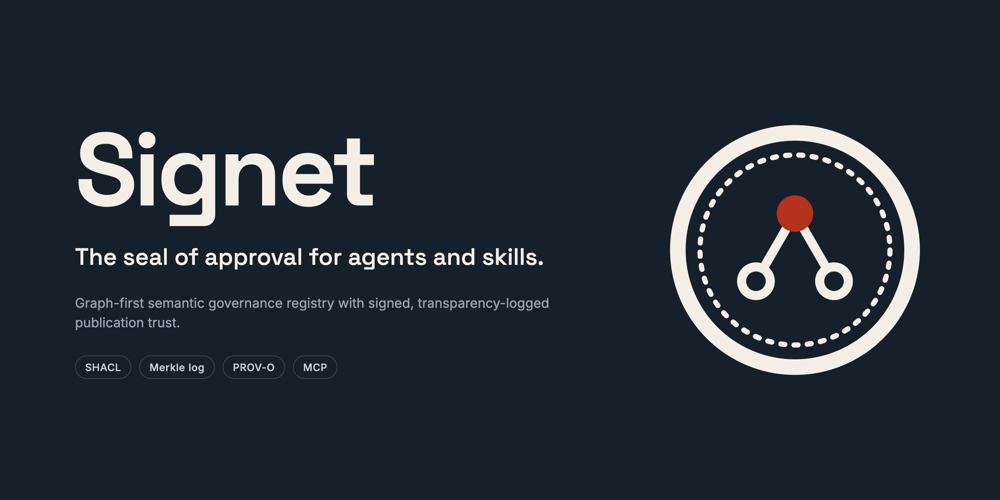
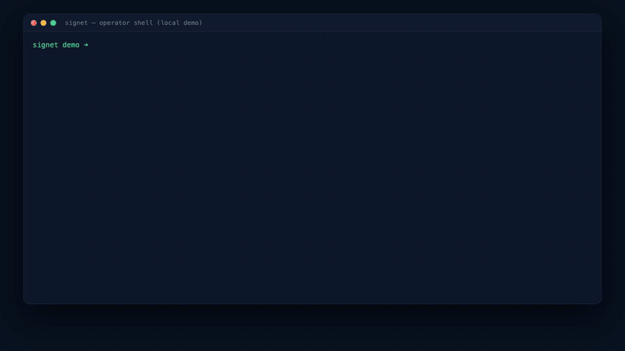

# Signet

<p align="center">
  
</p>

<a href="https://github.com/therandomsecurityguy/signet/actions/workflows/test.yml"></a>
<a href="LICENSE"></a>
<a href="https://nodejs.org"></a>
<a href="https://www.typescriptlang.org"></a>

**The seal of approval for agents and skills.**

Signet is a graph-first **semantic governance system** for autonomous
agents and computational skills. Most registries are catalogs: metadata
in, search out. Signet governs *meaning, release state, and evidence* —
and stamps every trusted publication with the proof to back it up.

What makes it different:

- **Logical identity ≠ publication snapshot.** Durable `AGENT`/`SKILL`
  identities are separated from immutable `AGENT_VERSION`/`SKILL_VERSION`
  snapshots, with real lifecycle semantics: supersession, revocation,
  archival.
- **Five-layer validation, not single approval.** Every version passes
  W3C SHACL graph-shape and policy validation, ontology validation,
  advisory LLM semantic analysis, and human review before it can be
  certified — with machine-readable evidence stored at each layer.
- **Cryptographic trust, not vibes.** Publication envelopes are
  canonicalized twice — operational JSON (RFC 8785 JCS) and semantic RDF
  (RDFC-1.0) — digested, and signed with detached signatures verified
  against trusted keys. Tampering is detected, not hoped away.
- **Transparency-logged governance.** Every lifecycle operation emits a
  canonical governance event into an append-only Merkle log with
  inclusion proofs and verifier replay; events anchor to a Tessera-backed
  external transparency log with checkpoints, witnesses, quorum, and
  split-view detection.
- **Dual ontologies.** Normative `registry_shape` and `skill_area`
  ontology packages govern what claims are publishable; unmapped claims
  are captured as de facto vocabulary candidates and promoted only
  through human review.
- **Certification is a pipeline, not a flag.** Versions move through
  `draft → validated → published → certified` (with `rejected`,
  `deprecated`, `revoked`, `archived`) with evidence requirements and
  policy/ontology binding at each stage.
- **Provenance you can replay.** PROV-O modeling links every snapshot to
  the activities, agents, policies, and ontologies that produced it —
  with traversal and audit-replay endpoints.

Signet is valuable when humans and AI agents can:
- discover useful capabilities quickly
- load the real implementation artifacts
- understand provenance and trust
- use approved data and process skills safely

### Why this exists

Inside the company, useful agent files, skills, runbooks, and process knowledge tend to proliferate faster than governance.

That creates three problems:
- people do not know what already exists
- agents cannot tell which artifacts are current and trustworthy
- operational knowledge becomes stale or duplicated

Signet is the answer we are building:
- metadata that is discoverable
- artifacts that are linked and loadable
- lifecycle and certification signals that make trust visible
- MCP and API planes that let humans and agents use the same source of truth

### Trust model

This project is not only about metadata.

It is about:
- discoverability
- artifact availability
- provenance
- currentness
- certification
- operator confidence

The skill happy path should be:
1. discover
2. inspect
3. load
4. trust
5. use
6. certify
7. recertify

See:
- `docs/governance-model.md`
- `docs/artifact-storage.md`

### Implemented now

Publication and lifecycle:
- lifecycle-aware publication for skills **and** agents with full parity
- certification state machine: `draft`, `validated`, `rejected`,
  `published`, `certified`, `deprecated`, `revoked`, `archived`
- deterministic draft rejection with recorded validation failures
- supersession guards (revoked snapshots are never superseded)
- certification bound to concrete policy and ontology versions, with
  optional expiry
- publication envelopes with detached signatures (outside the canonical
  payload), provenance/revocation/supersession references, and
  multi-algorithm cryptographic verification
- authenticated/audited writes

Canonicalization and signatures:
- RFC 8785 (JCS) canonical JSON for publication envelopes and governance
  events, with per-publication `canonicalization_algorithm` and legacy
  fallback
- canonical RDF (RDFC-1.0) projection of publication graphs with semantic
  digests recorded at publish and certify
- frozen publication envelope artifacts at publish, CAS digest verification on
  every read (`warn` by default, `enforce` opt-in), and explicit live-drift
  reporting in publication verification
- HTTP artifact byte access (`GET|HEAD /v1/artifacts/{sha256}`) with
  `Content-Digest` and fail-closed verification (unverified bytes are never
  transported)
- DSSE/in-toto attestation ingestion (`POST /v1/attestations`) with PAE
  signature verification against trusted keys, subject binding to publication
  artifacts, `sg:attestedBy` evidence links, and aggregates in publication
  verification
- policy-driven trust gates: `require_validation` at publish and
  `require_signature` / `require_trusted_publisher` / `require_build_provenance`
  / `require_sbom` at certification, evaluated against verified signatures and
  DSSE attestations
- verify-then-load consumer contract: SDK verification helpers
  (`verifyEnvelopeSignatures`, `verifyDetachedSignature`,
  `verifyRfc6962InclusionProof`, `fetchArtifact` with local re-hashing) and
  `registry-operator verify publication|artifact`; see
  `docs/supply-chain-model.md`
- `signet.lock`: per-consumer pins of exact publications
  (`registry-operator lock --skill key[@v]`, also `--agent`) recording
  `{type, key, version, publication_urn, envelope_sha256, artifact
  sha256s}`, with `registry-operator verify lock` as a fail-closed doctor —
  missing/revoked/drifted/expired pins fail with a non-zero exit;
  deprecated and newer-active versions warn (fail under `--strict`); run in
  CI for repos and at session start for agents
- dual signatures: detached signatures over operational (JSON) or
  semantic (RDF) canonical bytes with cross-verification

Validation (five layers):
- built-in graph-shape validation (authored as W3C SHACL Turtle) and
  policy packages as versioned CAS artifacts
  (`POST /v1/policy-packages`) in legacy JSON and authored SHACL Turtle
  formats
- W3C SHACL Core execution (`rdf-validate-shacl`, in-process) over
  derived RDF with focus-scoped targeting and RE2-backed pattern
  execution (ReDoS-safe by construction); SPARQL constraints/targets run
  on a hybrid `shacl-engine` adapter, and SHACL-AF rules, SPARQL
  functions, and custom SPARQL-based constraint components execute on an
  optional pyshacl runtime sidecar (`service/shacl-runtime`) that
  receives prepared shapes only — those policies fail closed without it
- machine-readable violation reports (SHACL result vocabulary; recorded
  `validator: shacl-v1`, engine id, and per-layer shapes fingerprints)
  stored in the CAS and linked via `sg:validatedBy`
- dual ontology packages (`registry_shape` / `skill_area`) as versioned
  CAS artifacts (`POST /v1/ontology-packages`) in two authoring formats:
  legacy JSON documents and authored OWL Turtle (`ontology_format:
  "owl-turtle"`, a totally-projected subset with registration-time
  refusals); every package carries an RDFC-1.0 canonical semantic
  projection (format-independent digest + artifact)
- ontology validation of `capability_claims`: concept binding, disjoint
  combination rejection (propagated through the subclass hierarchy with
  the disjoint ancestor pair as evidence), de facto candidate recording;
  bound ontologies are also exposed to SHACL execution (claim concept
  IRIs + subclass taxonomy) so policies can use `sh:class` with hierarchy
  semantics
- advisory LLM validation (model-agnostic port, deterministic heuristic
  default) with a generic HTTP JSON seam and an OpenAI-compatible Chat
  Completions backend (sanitized model responses; any failure falls back
  to the heuristic) emitting scorecard/prompt/confidence evidence
- human review workflow: review decisions as first-class
  `review_evidence` artifacts via `sg:reviewedBy`, policy-driven
  `require_human_review` gating at publish/certify, and a pending-review
  queue (`/v1/reviews/pending`)

Authored Turtle policies are registered with `POST /v1/policy-packages`
(`shapes_format: "shacl-turtle"`). A minimal policy — require a description
on every skill version — looks like:

```turtle
@prefix sh: <http://www.w3.org/ns/shacl#> .

<urn:policy:description> a sh:NodeShape ;
    sh:targetClass <urn:sg:entity-type:SKILL_VERSION> ;
    sh:property [
        sh:path <urn:sg:property:description> ;
        sh:minCount 1 ;
        sh:message "description_required_by_policy" ;
    ] .
```

The [local demo walkthrough](docs/local-demo.md#shacl-policy-walkthrough-verified)
registers this policy end to end and inspects the resulting validation report.
A recorded run of the same walkthrough — plus the browser console — is in
[`docs/demo/signet-demo.mp4`](docs/demo/signet-demo.mp4).

Transparency and provenance:
- trusted `PUBLIC_KEY`, `TRANSPARENCY_LOG`, and `TRANSPARENCY_WITNESS`
  trust roots
- transparency checkpoint registration, checkpoint history, and
  RFC 6962 consistency-proof validation
- witness attestations, quorum checks, checkpoint observations,
  disagreement evidence, gossip events, and timeline/provenance views;
  gossip stores fail closed (attached witnesses only, source must hold
  checkpoint evidence, relay chains verified with consistent hop depths and
  exposed as `relayed_from_event_urn`); waxing-style witness cosignatures
  on signed notes are verified against attached witnesses with fail-closed
  handling and distinct-witness quorum counting; cross-log coverage
  reporting with opt-in advisory trust scoring
- minimal signed-note checkpoint ingestion seam that verifies the
  transparency-dev spec note format (Ed25519, name-bound key hash,
  `<name>+<hash8hex>+<base64>` verifier keys) alongside the legacy
  SPKI-hint format, with fail-closed hint binding and
  `TESSERA_LOG_NOTE_VERIFIER` for spec reconciliation; the native sidecar
  emits spec notes when configured with `TESSERA_LOG_NOTE_KEY` (signing
  byte-verified against golang's note library with a shared fixture) and
  serves the C2SP tlog-tiles read API (`/tiles/<logId>/…`: checkpoint
  note, hash tiles, entry bundles — fixture-verified against
  transparency-dev's `tessera/api` layout)
- canonical governance events for every lifecycle operation, stored as
  immutable CAS artifacts and appended to an internal Merkle log with
  RFC 6962 inclusion-proof generation and verifier replay
  (`/v1/governance-log*`)
- governance-event digests staged through the Tessera sidecar for all
  lifecycle operations when configured
- PROV-O provenance: `prov:wasDerivedFrom` / `prov:wasGeneratedBy` /
  `prov:used` / `prov:wasAssociatedWith` edges written at every lifecycle
  operation, plus export-side version lineage (`prov:wasRevisionOf` between
  same-entity versions, `prov:specializationOf` to logical entity URNs),
  qualified associations (`prov:Association` nodes with agent + role), and
  revocation invalidation (`prov:wasInvalidatedBy`), with traversal +
  audit-replay endpoints and the read-only `registry.get_provenance` MCP
  tool
- canonical provenance export: the read view projects to a deterministic
  PROV-O graph — RDFC-1.0 canonical N-Quads with a content-addressed
  artifact and digest on every response, plus a JSON-LD representation
  (`?format=jsonld`); **detached provenance signatures** bind that digest
  (reads re-verify with `valid` / `invalid` / `stale` verdicts — stale
  marks signatures made before the trail grew, and the signed export
  stays retrievable); `registry-operator verify provenance` and the SDK's
  `verifyProvenanceSignature` reproduce verdicts locally; evidence
  artifacts (exports, signatures, report RDF) also stage transparency
  append intents and reconcile against the companion log
- validation reports as standardized RDF: every report artifact carries a
  `sh:ValidationReport` JSON-LD representation of its layers and results
  with its own RDFC-1.0 canonical digest + artifact; report artifacts are
  signable by trusted keys over that canonical RDF
  (`GET|POST .../report-signatures`) and re-verifiable locally
  (`registry-operator verify report-signatures`)

Ingestion and vocabulary:
- semantic compiler ingestion: markdown frontmatter and tool manifests
  compile to normalized capability claims at `POST /v1/compile/skill`
- de facto vocabulary store with human-reviewed promotion into new
  normative ontology versions (`/v1/de-facto-terms*`): within the source's
  authoring format (authored-OWL sources promote into new authored-OWL
  versions via the deterministic writer) or one-way cross-format legacy
  JSON → authored OWL via `target_ontology_format`; read-only corpus
  mining (`GET /v1/de-facto-terms/analysis`) classifies every claim across
  version snapshots as bound/unbound with occurrence and drift stats

Discovery and freshness:
- trust-ranked lists and search (`sort=trust`): structural tier dominance
  (certification state outranks freshness), 180-day recency decay, and
  score components always exposed next to the score; default ordering for
  MCP search
- deterministic semantic search (`mode=keyword|semantic`) over
  descriptions, capability claims, and ontology concepts with match
  evidence (`matched_claims` / `matched_terms`); keyword behavior preserved
- advisory dedupe detection at validation: near-duplicate candidates are
  recorded as evidence, never blocking
- operator-curated tags: normalized free-form tags with list/search
  filters and webapp chips
- freshness/staleness signals per version: derived from `certified_at` /
  `published_at` / `validated_at` (now recorded on the version node at
  validation) with fresh → aging → stale windows (90/180 days) and
  certification-expiry tracking (`certification_expired`,
  `expires_in_days`); exposed on API version details, version lists,
  ranked lists, and search, on MCP `registry.search` and
  `registry.get_skill` / `registry.get_agent`, and as webapp chips
- trust event feed: `GET /v1/events` reads the recorded governance
  events (publication, revocation, deprecation, certification,
  revalidation, recertification, …) newest-first with filters
  (`event_type`, `publication_urn`, `logical_key`, `since`/`until`) and
  their Merkle log positions (so consumers can request inclusion proofs
  for exactly the events they act on); `GET /v1/events/stream` is a
  Server-Sent Events stream over the same filters with a position cursor
  (`since_position`, `-1` replays from the start) — poll-backed against
  the shared log, so it is cross-replica safe with delivery latency equal
  to the poll cadence (`EVENTS_STREAM_POLL_MS`, default 3s)
- recertification queue + scheduled re-validation: `GET
  /v1/recertification/queue` ranks live versions whose verification is
  aging (`approaching`) or stale/expired/failed (`due`); recorded
  `revalidate` operations (`POST .../versions/:v/revalidate`) re-run the
  validation layers and store the outcome (`revalidated_at`,
  `revalidation_status`, failures as evidence) without ever changing
  lifecycle status, and restart the freshness clock; `recertify` (`POST
  .../versions/:v/recertify`) runs validation first and — only when it
  passes — renews the certification in place (fresh `certified_at`, a
  supplied `certification_expires_at` replacing the old deadline, fresh
  certification evidence, same gates as certify); bounded revalidation
  jobs (`/v1/revalidation-jobs`, durable planned → completed with a
  results evidence artifact, idempotent replay) run the queue on demand
  and from a chart CronJob (`revalidation.enabled`, disabled by default);
  the webapp surfaces the queue at `/recertification` with one-click
  Revalidate/Recertify forms, and certified version cards offer both
  actions

Storage and operations:
- content-addressed artifact storage (filesystem or S3) with per-artifact WORM reporting: `GET /v1/artifacts/{sha256}/retention` surfaces S3 Object Lock mode/retention/legal hold straight from the bucket, so immutability is provable per artifact
- Fuseki-backed metadata by default, with a persistent local JSON-file
  backend for development
- time-aware object slice: commits, refs, tags, workspaces, manifests,
  retention roots
- durable, non-destructive GC job execution seam
- GitHub Actions CI for service/api, service/mcp, shacl-runtime, and
  tessera-sidecar

Proposed next (not implemented yet):
- SHACL node expressions and `sh:js` (refused at registration; no
  execution semantics implemented); AF execution intentionally stays
  out-of-process — decided in `docs/shacl-af-in-process-design.md`
- legacy Trillian log backend support (Tessera is the implemented transparency backend; reconciliation, cross-log anchoring, and WORM reporting are shipped)

### Get it to run

If you want the quickest local path — no Docker, no AWS, no Kubernetes:

```bash
for d in service/api service/mcp service/webapp/knowledge-manager client/registry-cli; do
  (cd "$d" && npm ci)
done
scripts/demo-local.sh demo
```

That starts api (:3100), mcp (:3000), and the webapp (:3200) against local
SQLite/JSON-file/filesystem backends and seeds the blessed demo pack
(1 agent, 2 published skills — each validated through the W3C SHACL engine)
with `registry-operator`. See
`docs/local-demo.md` for the Docker Compose and local-Kubernetes (kind)
variants that keep the same no-AWS property, and for the verified
SHACL policy walkthrough.

<p align="center">
  <a href="docs/demo/signet-demo.mp4">
    
  </a>
</p>

Recorded walkthrough (65s, click for full quality): the operator shell runs
`scripts/demo-local.sh status`, registers an authored **W3C SHACL Turtle
policy**, shows a draft **rejected with the policy's message**, prints the
machine-readable report (`validator: shacl-v1` + engine + policy shapes),
and `registry-operator verify publication` returns `verdict: verified` —
followed by the web console, graph explorer, and OpenAPI docs.
Full video: [`docs/demo/signet-demo.mp4`](docs/demo/signet-demo.mp4)
(source script: `service/webapp/knowledge-manager/scripts/demo-video.ts`).

Then verify:

```bash
curl -s http://localhost:3000/healthz
curl -s http://localhost:3100/healthz
curl -s http://localhost:3200/healthz
```

Expected:
- `service/mcp` on `http://localhost:3000`
- `service/api` on `http://localhost:3100`
- `service/webapp/knowledge-manager` on `http://localhost:3200`

Current local metadata defaults:
- `service/api` in compose defaults to the persistent local `json_file` graph state at `data/registry/graph/registry-state.json`
- local Fuseki-backed `sparql` remains available as the optional inspection and live-validation backend for operators

Current artifact default:
- filesystem CAS under `data/registry/objects/`

### Best human entrypoints

Start here:
- `docs/governance-model.md`
- `docs/tessera.md`
- `DEMO.md`
- `docs/quick-value-roadmap.md`
- `docs/blessed-demo-path.md`
- `docs/fuseki-query-pack.md`
- `docs/graph-ui-plan.md`

### Human Proof Runs

The current team-facing proof story has four lanes:
1. inspect the committed real sample shape
2. seed that sample through the real operator path and print reports
3. run happy-path and unhappy-path verification tests

#### 1. Inspect the committed real sample

Run from:

```bash
cd signet/client/registry-cli
```

Print the committed transparency sample without requiring the stack or an API token:

```bash
npm run dev -- seed transparency-sample --spec examples/transparency/sample-graph.spec.json --dry-run
```

This uses the checked-in sample under:
- `client/registry-cli/examples/transparency/sample-graph.spec.json`

#### 2. Seed the real sample and print reports

Create a write API key first if you do not already have one:

```bash
cd signet/service/api
npm run create-api-key -- --owner-label "Teammate Sample Run"
```

Then seed the committed sample through the real operator path:

```bash
cd signet/client/registry-cli
npm run dev -- seed transparency-sample --api-token "<api-token>" --spec examples/transparency/sample-graph.spec.json
```

That prints:
- the seeded sample metadata
- the transparency log payload
- the verification payload
- the timeline payload

For a smaller human-facing report instead of the full JSON payloads:

```bash
cd signet/client/registry-cli
npm run dev -- seed transparency-sample --api-token "<api-token>" --spec examples/transparency/sample-graph.spec.json --human-proof-report
```

What the seeded real sample models:
- one transparency log
- one trusted checkpoint key
- two witnesses
- two checkpoints
- one conflicting same-size-different-root observation
- one witness-to-witness gossip event

#### 3. Run happy-path and unhappy-path trust tests

Run these from:

```bash
cd signet/service/api
```

Happy path for a markdown-backed skill publication:

```bash
npx vitest run tests/unit/skill-lifecycle.test.ts -t "shows a happy-path trust story for a markdown skill publication" --reporter=verbose
```

This proves:
- the publication envelope still matches the signed state
- a trusted public key is resolved
- cryptographic verification passes
- the transparency proof validates against the trusted checkpoint/log model

Unhappy path showing tamper-evident failure after a signed publication changes:

```bash
npx vitest run tests/unit/skill-lifecycle.test.ts -t "shows tamper-evident failure for a signed markdown skill publication after state changes" --reporter=verbose
```

This proves:
- the later mutation is detected
- `verification_status: signature_mismatch`
- `transparency_verification_status: mismatch`
- signer, key, log, and proof context remain visible for human inspection

#### 4. Run realistic sample-graph integration proofs

Persistent local proof over real HTTP with the `json_file` backend:

```bash
npx vitest run tests/e2e/transparency-blackbox.test.ts --reporter=verbose
```

Live Fuseki/SPARQL proof:

```bash
ENABLE_LIVE_SPARQL_E2E=1 \
REGISTRY_SPARQL_QUERY_URL=http://127.0.0.1:3030/registry/sparql \
REGISTRY_SPARQL_UPDATE_URL=http://127.0.0.1:3030/registry/update \
REGISTRY_SPARQL_USERNAME=admin \
REGISTRY_SPARQL_PASSWORD=admin \
npx vitest run tests/e2e/api-sparql-live.test.ts --reporter=verbose
```

What these prove today:
- the operator CLI can seed a committed real sample that teammates can inspect and replay
- the happy-path skill test shows a valid signed and transparency-verified publication
- the unhappy-path skill test shows a tamper-evident trust failure with preserved forensic context
- the e2e lanes prove the same trust story over realistic sample graphs, first with persistent local `json_file`, then with live Fuseki/SPARQL

### Fast demo path

If you want the current blessed demo:

```bash
cd signet/client/registry-cli
npm install
npm run dev -- bootstrap test --reset --force --up
```

That command seeds:
- one demo agent: `cursor:registry-agent`
- one MCP usage skill: `skill:registry-mcp`
- one fun proof skill: `skill:tame-llama`

The operator CLI now also supports:
- richer multi-skill / multi-agent bootstrap packs with profiles and dependency-aware planning
- a second real-Okta bootstrap verification lane for the registry-admin surface

### Fresh bootstrap path
For a fresh local registry bootstrap, the intended operator sequence is:
1. start the stack with `cd signet/infra && make up`
2. mint write credentials for `service/api`
3. seed lifecycle-aware skills first
4. seed agents that reference those skills
5. verify discovery/load through `service/mcp`

Important bootstrap rule:
- skills must be seeded before agents that reference them
- lifecycle-aware bootstrap should use the skill lifecycle endpoints, not only `POST /v1/skills`
- the future home for this workflow is `client/registry-cli`

### High-level architecture (intended)
- **Domains**: registry entities and relationships (graph-first metadata model).
- **Connect**:
  - **MCP** adapter(s) for agent harnesses (Cursor, Claude Code, etc.)
  - **API** surfaces for programmatic interaction (canonical contracts)
- **Human interfaces**:
  - Web UI for browsing/operating the registry
  - current thin launchpad under `service/webapp/knowledge-manager`
- **Data/Storage**:
  - Graph database for registry metadata and relationships (planned / evolving)
  - Content-addressable artifact store for agent/skill source files (planned / evolving)
- **Processes**:
  - Validation/certification and other operational processes (planned / evolving)

### Agent Data Access Gateway (this repo area)
Under `service/mcp/` we are building the **Agent Data Access Gateway** as specified in the spec pack at `service/mcp/AGENTS/`.

### Canonical boundaries
- `service/registry`
  - canonical internal registry core
- `service/api`
  - canonical external management plane for humans, webapp flows, and CI/CD
- `service/mcp`
  - canonical AI-facing plane

Current rule:
- `service/api` and `service/mcp` should consume shared registry logic directly
- `service/mcp` should not call `service/api` over HTTP inside the same service
- Jena/Fuseki stays behind adapters, not as the public contract

Key invariants:
- **MCP stays thin**: it is an adapter only.
- **Canonical Tool API is the source of truth**.
- **Read-only + auditability** are hard release gates.

Current implementation status (incremental):
- `service/mcp/`: PHASE 0–9 implemented and green (Tool API + MCP + auth + audit + safety + mock-first connectors + Stage 2 seams).
- `service/api/`: bootstrap skeleton plus first versioned `agents` and `skills` metadata API slices implemented and green, including artifact attachment semantics, skill linkage, and idempotent create behavior.
- `service/api/`: lifecycle-oriented management plane for skills **and** agents with full parity (draft/validate/publish/promote/deprecate/certify/revoke/archive/active-version resolution).
- `service/api/`: the certification state machine now covers `draft`/`validated`/`rejected`/`published`/`certified`/`deprecated`/`revoked`/`archived` with deterministic draft rejection, supersession guards, and policy/ontology-bound certification.
- `service/api/`: policy packages are first-class versioned artifacts (`POST /v1/policy-packages`) in legacy JSON and authored W3C SHACL Turtle formats; draft validation executes W3C SHACL Core for the built-in graph shape and policy shapes, stores machine-readable violation reports in the CAS, and links them via `sg:validatedBy`.
- `service/api/`: dual ontology packages (`registry_shape` / `skill_area`) are versioned artifacts (`POST /v1/ontology-packages`) in legacy JSON and authored OWL Turtle formats, each carrying a format-independent canonical semantic digest; draft validation checks `capability_claims` bind to known skill-area concepts, rejects disjoint combinations, records de facto candidates, and binds certification to registered ontology packages.
- `service/api/`: advisory LLM validation runs as a fourth, always-non-blocking layer with scorecard evidence artifacts; human review records decisions as `review_evidence` artifacts with policy-driven gating and a pending-review queue.
- `service/api/`: semantic compiler ingestion (`POST /v1/compile/skill`) normalizes markdown and tool manifests into typed proposals, with a de facto vocabulary store and human-reviewed promotion.
- `service/registry` and `service/api` now expose the first time-aware object slice (commits, refs, tags, workspaces, manifests, retention roots, GC jobs) with a first public draft-workspace operation and a durable, non-destructive GC job execution seam.
- `service/api/` now defaults to a persistent local graph adapter for metadata writes in local development.
- `service/api/` also exposes an optional SPARQL-backed graph seam, with the default testsuite now including a black-box e2e API test.
- local Fuseki/Jena is now available in compose, and the env-gated live SPARQL API e2e path has been validated successfully.
- `service/api/` write routes now require auth and persist audit/auth state in SQLite.
- `service/mcp/` now includes a repeatable registry bootstrap CLI that can seed the configured persistent graph backend plus CAS for beta environments.
- `service/webapp/knowledge-manager/` now goes beyond browsing and exposes first registry-admin read/write flows over `service/api` (agent registration, skill registration, and skill draft creation).
- `service/registry` and `service/api` now expose a real transparency/governance trust layer with trusted public keys, transparency logs, transparency witnesses, checkpoint history, consistency proofs, witness attestations, observations, disagreement evidence, gossip events, timeline inspection, signed-note compatibility, richer note parsing, temporal witness forensics, and stronger provenance on observations and gossip.
- `service/registry` now emits canonical governance events for every lifecycle operation into an internal append-only Merkle log, with inclusion-proof generation and verifier replay over `/v1/governance-log*`.
- `service/registry` now projects publication graphs to canonical RDF (RDFC-1.0) with semantic digests, and verifies dual (operational/semantic) detached signatures.
- `service/registry` now tracks PROV-O provenance for all lifecycle operations, with traversal and audit-replay endpoints and the read-only `registry.get_provenance` MCP tool.
- `service/api` now serves a generated OpenAPI 3.1 spec at `GET /v1/openapi.json` and a Swagger UI at `GET /v1/docs`, derived from the route contracts via `@hono/zod-openapi`.
- `client/registry-sdk` now provides a typed, read-first client SDK (`@signet-registry/sdk`) generated from the OpenAPI spec, with a CI publish workflow on `registry-sdk-v*` tags.
- `service/mcp` now exposes a `registry.search` discovery tool so a fresh agent can self-orient by searching skills and agents, plus a read-only `registry.verify_publication` tool that returns envelope digest, signature, and transparency verdicts for a version.
- `service/mcp` now includes an opt-in cognitive layer that estimates tool-result token cost and summarizes payloads that exceed a configured LLM context budget, with ephemeral summary caching.
- the repo now includes Terraform for a locked-down shared S3 bucket seam, Aurora/Secrets Manager wiring for the Tessera AWS backend state, and optional `tessera-sidecar` / `tessera-runtime` companions for future transparency-backend experiments.
- publish/certify flows can now stage real publication/governance append intents through the sidecar and preserve the returned S3 references in the trust model when the sidecar is configured.
- Note: external warehouse connections and Okta validation may run in **MOCK** mode in early phases to stay unblocked (documented in `service/mcp/README.md`).

### Agent integration surfaces
Signet is designed to be available to every agent workflow. The current surfaces:
- **OpenAPI 3.1 spec + Swagger UI** — `GET /v1/openapi.json` and `GET /v1/docs` on `service/api`. See `docs/api-reference.md`.
- **Typed read-first SDK** — `@signet-registry/sdk` under `client/registry-sdk`, generated from the spec. See `client/registry-sdk/README.md`.
- **MCP gateway** — `service/mcp` exposes read-only `registry.*` tools (including `registry.search`, `registry.verify_publication`, and `registry.get_attestations`) over Streamable HTTP at `/mcp`. See `docs/mcp-onboarding.md` for per-harness config (Claude Code, Cursor, opencode, generic MCP clients).
- **Cognitive layer** — opt-in token-context estimation + summarization in `service/mcp` (see `service/mcp/README.md`).
- **Operator CLI** — `@signet-registry/operator` under `client/registry-cli`, packaged for CLI-first agents (see `client/registry-cli/README.md`).
- **Onboarding skill** — a distributable `signet-registry` skill teaching the discover → inspect → load → trust → use flow (see `skills/` and `.cursor/skills/signet-registry/`).

### Infrastructure
- System-level infra (compose, shared networking, shared volumes, env wiring): `infra/`
- Per-service infra:
  - `service/mcp/infra/`
  - `service/api/infra/`
  - `service/registry/infra/`
  - `service/webapp/knowledge-manager/infra/`
- Local operator entrypoint:
  - `cd infra && make up` (uses base + override compose files)

### Production deployment (two-repo rule)
- This repo ships release-tagged artifacts only: immutable, digest-pinned images
  and the Helm chart (`charts/signet`), published to GHCR
  (`ghcr.io/<owner>/signet/…`) by `.github/workflows/release.yaml` with the
  workflow's `GITHUB_TOKEN` — no cloud account or static credentials.
- The environment repo that owns Terraform state applies the pinned
  chart via the `signet-eks` module.
- Reusable Terraform modules live under `infra/terraform/modules/` (needed only
  for the AWS/EKS deployment path — the release pipeline itself is provider-free):
  - `signet-registry` — immutable ECR repos + GitHub OIDC publish role (optional ECR mirror)
  - `signet-data` — KMS, Secrets Manager, S3 artifacts, RDS Postgres, ElastiCache Redis, IRSA
  - `signet-eks` — version-pinned Helm release wrapper
- Deploy runbook: `docs/runbooks/deploy.md`; secrets: `charts/signet/SECRETS.md`.

### Human docs
- local operator guide: `docs/local-development.md`
- adopting the deployed registry: `docs/adoption.md`
- deploy runbook: `docs/runbooks/deploy.md`
- demo data reseed: `docs/runbooks/demo-reseed.md`
- WORM artifact storage (S3 Object Lock): `docs/runbooks/worm-artifacts.md`
- off-platform migration/cutover: `docs/runbooks/migration-cutover.md`
- service boundaries: `docs/service-map.md`
- registry domain/storage model: `docs/registry-model.md`
- SHACL-AF execution boundary (in-process vs sidecar): `docs/shacl-af-in-process-design.md`
- API reference: `docs/api-reference.md`
- MCP onboarding: `docs/mcp-onboarding.md`
- beta-v1 readiness and scope: `docs/beta-v1-readiness.md`
- docs index: `docs/README.md`

### Service entrypoints
- `service/mcp/README.md`
- `service/api/README.md`
- `service/registry/README.md`
- `service/shacl-runtime/README.md`
- `service/tessera-sidecar/README.md`
- `service/tessera-runtime/README.md`
- `service/webapp/README.md`
- `service/webapp/knowledge-manager/README.md`
- `client/registry-cli/README.md`
- `client/registry-sdk/README.md`

### Registry (agents/skills) direction
We are extending the system to provide a **graph-first registry** of agents and skills, exposed via canonical `registry.*` tools and the MCP adapter.

### Beta v1 recommendation
The most credible first beta should be scoped narrowly to:
- authenticated AI agents discovering agents and skills through `service/mcp`
- those agents loading linked artifact content from the registry
- internal operators managing registry metadata through `service/api`

The broader human knowledge-manager track under `service/webapp/knowledge-manager/` should be treated as a parallel product track, not as a release gate for the first internal beta unless explicitly expanded.

Current implementation note:
- the webapp now exists as a thin runnable admin surface over `service/api`
- the webapp now supports a minimal server-side management session and browser-driven skill lifecycle operations
- the webapp auth/session flow now aligns to the `service/api` auth direction: API-key fallback for local mode, Okta-style session acquisition for `okta` / `dual`
- the webapp session store is now durable via local SQLite persistence
- real Okta-backed ontology access via the Semantic Turkey / VocBench companion remains intentionally deferred
- ontology authoring is still intentionally externalized to VocBench / Semantic Turkey rather than rebuilt inside the repo webapp
- optional local VocBench / Semantic Turkey can be enabled as a compose companion for ontology-authoring experiments

### Credits

Signet is built by [Derek C.](https://github.com/therandomsecurityguy) and
[Pablo Ferrari](https://github.com/pabshazon).
