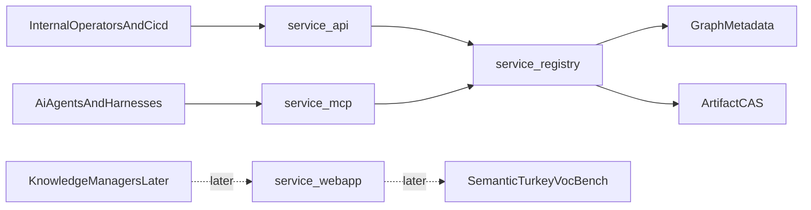

## Beta V1 Readiness

This document defines the most credible **beta v1** for **Signet**.

### Recommended beta promise
Beta v1 should be scoped narrowly to the parts of the system that are already structurally real:
- authenticated AI agents can connect through `service/mcp`
- those agents can discover `agents` and `skills` from the registry
- those agents can load linked text artifacts from the registry CAS
- internal operators can manage registry metadata through `service/api`
- graph metadata and artifact bytes persist durably enough for internal use

### What beta v1 is not
Beta v1 should **not** imply the full human knowledge-management product yet.

Specifically defer:
- ontology/model/data authoring as a finished human product
- full VocBench / Semantic Turkey integration
- real Okta-backed ontology access across the companion knowledge-authoring runtime
- broad multi-user governance workflows in a web UI
- public or external-user readiness

### Current readiness view
- `service/mcp` + shared registry core:
  - closest to beta
  - strongest candidate for the first internal user promise
- `service/api`:
  - full lifecycle management plane for skills and agents (draft/validated/rejected/published/certified/deprecated/revoked/archived)
  - policy packages, ontology packages, semantic compile, human review, provenance, and governance-log surfaces implemented
- `service/webapp/knowledge-manager`:
  - now exists as a thin runnable launchpad
  - still not yet a full knowledge-management beta product surface
  - registry-admin auth/session work is progressing, but companion ontology access remains intentionally separate

### Canonical boundaries for beta
- `service/registry`
  - canonical internal domain/application layer
- `service/api`
  - canonical external management plane for humans, webapp flows, and CI/CD
- `service/mcp`
  - canonical AI-facing plane

Important boundary rules:
- `service/api` and `service/mcp` both call shared registry logic directly
- `service/mcp` does not call `service/api` over HTTP
- Jena/Fuseki remains behind adapters, not as the public contract
- the trust layer is now a full cryptographic publication pipeline: RFC 8785 (JCS) + RDFC-1.0 canonicalization, dual detached signatures, verification endpoints, and an internal governance Merkle log with inclusion proofs and replay

### Beta topology

### Primary gaps before calling beta real
- MCP registry read semantics need stronger explicit not-found/error behavior
- MCP registry reads need stronger registry-specific authorization posture
- registry bootstrap/ingest must be durable and repeatable for internal environments
- AWS deployment path needs stronger release/persistence/secrets/observability posture
- semantic-governance hardening is largely delivered (publication evidence fields, dual canonical digests and signatures, SHACL-like policy and ontology validation); remaining hardening:
  - broader beta bootstrap coverage for the new governance surfaces
  - AWS deployment path needs stronger release/persistence/secrets/observability posture

### MCP gap priorities
For the narrow beta, the MCP-facing backlog should be prioritized as:
1. durable registry bootstrap/population
2. continued registry-specific authorization hardening
3. artifact retrieval/reliability hardening as registry content grows

### Practical recommendation
Treat beta v1 as:
- **internal agent discovery/load beta**
- plus a supporting internal management plane

Treat human ontology/knowledge-management as:
- **parallel product track**
- not a release gate for the first beta unless explicitly expanded

### AWS path in one sentence
The shortest credible AWS beta is:
- deploy `service/api` and `service/mcp` as the two public planes
- keep `service/registry` as shared internal core
- replace local-state and local-secret assumptions with durable graph/artifact/operational persistence and centralized observability
