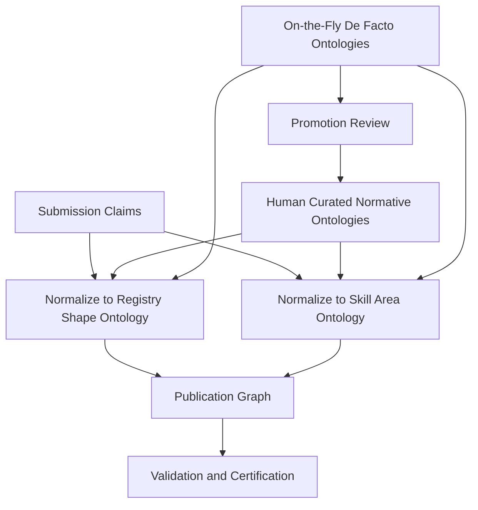
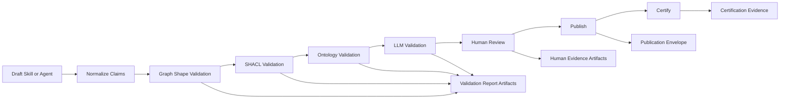
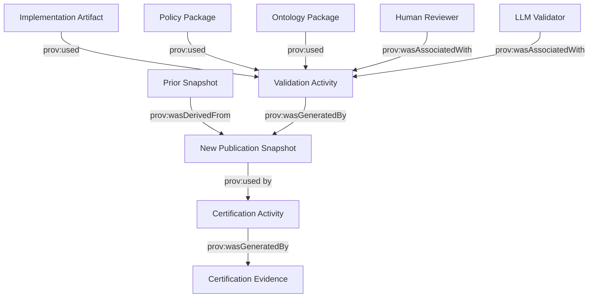
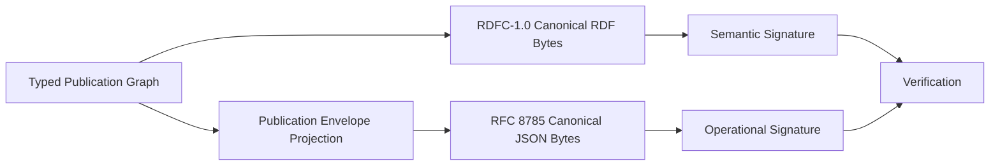
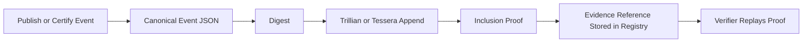
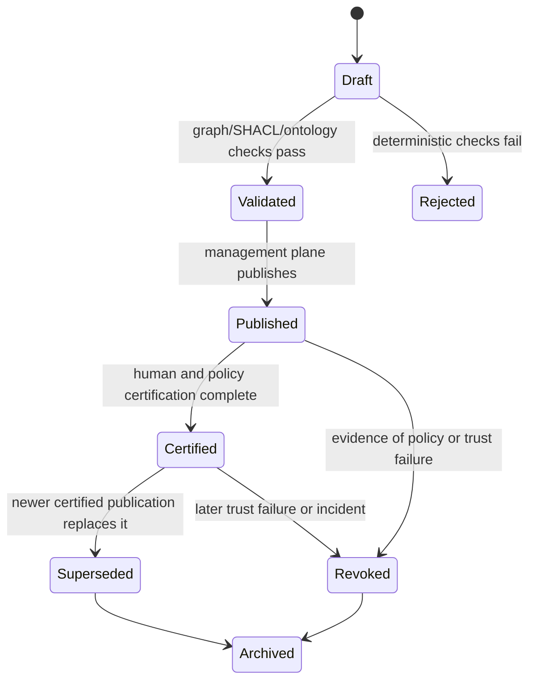

## Governance Model

This document defines the trust, publication, provenance, and certification model for **Signet**.

It is intentionally both:
- a description of what is implemented now
- a target architecture for the next semantic-governance layers

The core idea is that this registry should evolve toward a **semantic compiler for governed skills and agents**:
- humans and machines submit claims
- those claims are lowered into typed graph form
- the graph is validated against ontology, policy, and lineage rules
- canonical bytes are emitted deterministically
- evidence is logged immutably
- only then do we treat a skill or agent as trusted enough for discovery and use

## Why governance matters here

The registry is only strategically useful if humans and agents can answer:
- what is this thing?
- what is the enduring identity vs the immutable publication snapshot?
- who asserted it?
- what evidence supports the assertion?
- what policy validated it?
- what ontology terms define its meaning?
- what lineage explains how it was produced?
- what exact bytes were signed or certified?
- has it been revoked, superseded, or recertified?

Without those answers, a registry is only a catalog.

## Design thesis

### The registry is not only a database

The long-term goal is not just storage. It is a compiler-like governance pipeline for machine-operable trust.

Compiler analogy:
- source language: markdown, manifests, skill docs, agent docs, OpenAPI, runtime observations, human review notes
- intermediate representation: typed ontology-backed graph
- type system: registry ontology plus domain ontologies
- static analysis: SHACL, graph-shape checks, policy checks, ontology checks
- provenance/debug symbols: PROV-O activities, derivations, and agents
- deterministic build outputs: canonical RDF bytes and canonical JSON bytes
- release artifact: governed publication snapshot plus evidence bundle
- transparency/audit layer: append-only/WORM logs and Merkle commitments

This is how we get as close as possible to an NLP compiler:
- claims are normalized into typed meaning
- meaning is checked against shape and policy
- provenance is attached as first-class evidence
- the emitted canonical bytes are stable enough for signing, verification, and later replay

## Governance objectives

The governance scheme should ensure, as much as practically possible, that:
- skills and agents do what they claim to do
- claims are validated before publication and again before certification
- validation is evidence-based, not only opinion-based
- provenance and lineage are queryable, not buried in logs
- approvals and certifications are attributable to actors and policy versions
- canonical outputs are stable enough for deterministic signing
- audit logs are tamper-evident and retention-friendly
- revocation and supersession are operational states, not informal comments

## Ontology layers

We need two ontology families, not one.

### 1. Human-created normative ontologies

These are curated, governed vocabularies created deliberately by humans.

Examples:
- registry ontology describing `AGENT`, `AGENT_VERSION`, `SKILL`, `SKILL_VERSION`, publication evidence, certification state, lifecycle state, supersession, revocation
- area-of-knowledge ontologies for each skill family, such as:
  - content pipeline skills
  - data platform skills
  - motherduck/snowflake/athena skills
  - SDK-family skills

Purpose:
- define the allowed meaning space
- provide stable classes and properties
- express contract-level semantics
- keep the same skill claim interpretable across time and across implementations

### 2. On-the-fly de facto ontologies

These are emergent vocabularies inferred from real submissions, runtime observations, imported schemas, or corpus mining.

Examples:
- discovered parameter vocabularies from many `SKILLS.md` files
- recurring capability relations mined from tool manifests
- aliases and synonym clusters discovered in live content
- inferred domain concepts not yet promoted into the normative ontology

Purpose:
- speed up ingestion and normalization
- capture vocabulary actually used in the field
- detect where the normative ontology is missing useful concepts
- propose ontology promotions based on evidence rather than intuition

Important rule:
- de facto ontology terms may assist normalization and recommendation
- only normative ontology terms should define publication and certification policy

### Registry-shape ontology vs skill-area ontology

We need both:
- a **registry-shape ontology** for lifecycle, publication, evidence, provenance, revocation, supersession, certification
- a **skill-area ontology** for what a skill actually claims about a knowledge area or operational capability

That split is essential. Otherwise:
- the registry cannot reason about trust and lifecycle consistently
- domain semantics get mixed with governance semantics

## Validation and certification stack

Validation should never be a single pass. We want layered defenses.

### Required validation families

#### 1. Graph shape validation

Purpose:
- ensure the graph is structurally well-formed
- detect missing required fields, broken edges, wrong cardinalities, illegal lifecycle states

Examples:
- a `SKILL_VERSION` must point to an implementation artifact
- an `AGENT_VERSION` must point to at least one skill or explicit tool/capability set
- a publication envelope must declare the policy version that validated it

#### 2. SHACL validation

Purpose:
- treat policy as machine-readable data
- express admissibility requirements and explain failures deterministically

Examples:
- a skill in a regulated area may require explicit data-classification metadata
- an agent intended for autonomous action may require human-approval fields
- a certification-ready snapshot may require lineage completeness

Current implementation:
- policy packages are registered as versioned CAS artifacts and resolved by `policy_version`, in two authoring formats: legacy JSON shape documents (translated to SHACL before execution, byte-identical gating behavior) and authored W3C SHACL Turtle (`shapes_format: "shacl-turtle"`, with `require_*` gates as envelope metadata)
- validation executes W3C SHACL Core constraint components (Zazuko `rdf-validate-shacl`, in-process behind a swappable port) over an N-Quads dataset derived from the typed publication graph: focus properties and edges plus entity-type triples so `sh:class` can check edge targets
- targeting is focus-scoped: `sh:targetClass` shapes are rewritten to `sh:targetNode <focus>` for the matching entity type (other shapes go inert), so edge targets — including other versions reached via supersession edges — are never validated incidentally
- `sh:pattern` executes in the registry's linear-time RE2 layer rather than the engine's backtracking RegExp (ReDoS-safe by construction); patterns are RE2-compiled at registration and stripped before engine execution
- violations use the SHACL result vocabulary (focus node, result path, constraint component, source shape, severity) and are stored as CAS validation reports linked via `sg:validatedBy`; reports record the validator (`shacl-v1`), the engine version, and per-layer shapes fingerprints (`shapes_format`, `shapes_sha256`)

#### 3. Ontology-based validation

Purpose:
- make sure claims use known concepts and valid relationships
- prevent “looks structured but is semantically wrong” submissions

Examples:
- skill capability claims must bind to approved domain ontology terms
- skill inputs/outputs must be consistent with domain concepts
- prohibited semantic combinations should fail even when the graph shape is valid

Current implementation:
- ontology packages are registered as versioned CAS artifacts in two kinds: `registry_shape` (lifecycle/evidence vocabulary, governance evidence only) and `skill_area` (domain concepts executed against claims)
- versions declare `capability_claims` at draft time; validation requires every claim to bind to a known concept in the resolved skill-area ontology and rejects disjoint concept combinations
- unmapped claims fail normative validation and are recorded as de facto vocabulary candidates in the validation report (mining/promotion workflow remains future work)
- ontology packages currently use a JSON document format; first-class RDF/OWL vocabularies remain future work

#### 4. LLM-based validation

Purpose:
- evaluate free text, natural language claims, examples, and behavioral descriptions that are hard to formalize immediately

Use cases:
- compare title/description/examples against claimed capability
- detect overclaiming, ambiguity, or internal contradiction
- suggest missing ontology terms or policy warnings

Critical rule:
- LLM validation is advisory unless tied to a policy package
- it must emit evidence, scorecards, and prompts/results as artifacts
- it must never silently replace deterministic validation

Current implementation:
- a model-agnostic `LlmValidator` port runs as an advisory layer in draft validation; findings are Warning-severity only and never cause rejection
- the default validator is a deterministic heuristic analyzer (overclaim detection, ambiguity detection, example-capability consistency, missing-term suggestions) that runs offline; an HTTP model endpoint can be wired via `LLM_VALIDATOR_URL` with the heuristic as fallback
- every run stores an evidence artifact (prompt, scorecards, rationale, confidence, suggestions) in the CAS, linked via `sg:validatedBy`

#### 5. Human validation

Purpose:
- final review for correctness, safety, usefulness, and organizational fit

Use cases:
- release manager review
- domain expert review
- security/compliance review
- ontology curator review for newly promoted concepts

Human review is where judgment lives. The system should preserve that judgment as evidence, not reduce it to a boolean.

Current implementation:
- `POST /v1/skills/:key/versions/:v/review` and `POST /v1/agents/:key/versions/:v/review` record approve/reject decisions on validated or published versions
- each decision stores a `review_evidence` artifact (decision, reviewer, role, note) in the CAS, linked via `sg:reviewedBy`, and updates the version's review fields
- policy packages may declare `require_human_review: true`; publish and certify transitions for bound versions then require an approved review (rejected or unreviewed versions are blocked with 409)
- policy packages may also declare trust gates: `require_validation: true` blocks publish for versions that are still drafts, and `require_signature`, `require_trusted_publisher`, `require_build_provenance`, `require_sbom` bind at certification against the frozen envelope and the evidence attached after publish (verified detached signatures, trusted-key owner matching the publication publisher, and verified DSSE/in-toto attestations with SLSA-provenance or SPDX/CycloneDX-SBOM predicate types). Each failure raises a specific 409 code (for example `SKILL_VERSION_BUILD_PROVENANCE_REQUIRED`); when a policy requires a trusted publisher, attaching a detached signature with a key owned by anyone other than the publication's publisher is refused (`..._SIGNATURE_PUBLISHER_MISMATCH`)
- `GET /v1/reviews/pending` serves the review queue of unreviewed validated/published versions

### Validation flow

## PROV-O lineage

Trust requires provenance, not just state.

### Why PROV-O matters

PROV-O lets us answer:
- what generated this publication snapshot?
- what prior version did it derive from?
- which policy package was used?
- which validation report was produced?
- which human or service account approved it?
- what domain ontology version was used at decision time?

### What should be modeled

At minimum, each publication should be able to reference:
- the input artifacts it used
- the prior snapshots it derived from
- the validation activities that evaluated it
- the human and machine agents involved
- the policy packages and ontology versions in force

PROV-oriented entities:
- publication snapshot as `prov:Entity`
- source artifact as `prov:Entity`
- policy package as `prov:Entity`
- ontology package as `prov:Entity`
- validation run as `prov:Activity`
- publish/certify action as `prov:Activity`
- human reviewer, CI bot, or validation service as `prov:Agent`

## Canonicalization

Canonicalization is the boundary between “meaning” and “signable bytes”.

### Canonical RDF bytes

Why:
- the graph is the richest semantic representation
- RDF canonicalization lets us sign the semantics, not an accidental serialization order

Implemented standard:
- canonical RDF using **RDFC-1.0** (via rdf-canonize), projected from the typed publication graph at publish and re-projected at certification checkpoints
- the semantic digest (`canonical_rdf_sha256`) is recorded on the version and exposed on the envelope; verification re-projects the current graph and compares, detecting post-publication mutation
- detached signatures may sign canonical JSON (operational) or canonical RDF (semantic) bytes via `signed_payload`, enabling cross-verification of both signature classes over the same snapshot
- detached signature edges, the projection self-reference edge, and post-publication task edges are excluded from the projected graph so the semantic digest stays stable across evidence attachment

Why this matters:
- Turtle serialization order is not stable enough for signing
- graph signatures need deterministic blank-node treatment
- canonical RDF bytes are the basis for semantic verification, Merkle commitments, and long-term evidence durability

### Canonical JSON bytes

Why:
- many clients and verifiers will consume JSON publication envelopes first
- JSON is the practical interoperability layer for API, CI, and signatures in the near term

Implemented standard:
- canonical JSON using **RFC 8785 (JCS)** for all newly generated envelope and governance-event bytes
- the serializer lives in `service/registry/application/services/canonical-json.ts` and enforces UTF-16 code-unit key ordering, ECMAScript number serialization, and minimal string escaping
- each published version records `canonicalization_algorithm` (`jcs-rfc8785`); envelopes for versions published before the migration are re-derived with the legacy `json-key-sort-v1` serializer so existing signatures remain verifiable

Why both are needed:
- canonical JSON supports operational verification today
- canonical RDF supports semantic verification at the graph layer
- the long-term security model should treat them as companion projections of the same governed snapshot

## Publication envelope

The publication envelope is the practical verification object.

It should include:
- logical identity URN
- publication snapshot URN
- canonical JSON bytes
- canonical JSON digest
- links to implementation artifacts
- links to policy-package, validation-report, certification-evidence artifacts
- signer and signature references
- trusted public key references
- trusted transparency log references
- lineage and provenance references
- revocation and supersession references

Operational rule:
- clients should verify the envelope digest before trusting any linked signature
- the published envelope bytes are frozen as a CAS artifact at publish time and
  served as `canonical_json`, so signatures cover the published snapshot rather
  than the latest derived state
- verification reports `publication_envelope_artifact_sha256_matches` and
  `live_envelope_matches_frozen_artifact`; post-publish evidence changes the
  live derivation, and the drift is explicit instead of invalidating signatures
- clients can now validate artifact-backed inclusion-proof payloads against the envelope digest and signature artifact linkage
- later, clients should be able to verify Trillian/Tessera inclusion proofs cryptographically, not only structurally

## WORM audit and transparency

Normal application logs are not enough for high-trust governance.

We want a WORM-style audit trail for governance events using a transparency-log architecture such as:
- **Trillian** for Merkle-backed append-only log semantics
- **Tessera** for operational log integration and evidence anchoring

### What should go into the WORM trail

At minimum:
- publish requests
- certify requests
- revoke requests
- supersession transitions
- validation reports and their digests
- signature records
- inclusion proofs for released publication envelopes

### Why this matters

This gives us:
- tamper-evident audit history
- replayable certification evidence
- later forensic reconstruction
- stronger non-repudiation than database state alone

### Practical architecture

Short term:
- keep application audit events in SQLite and service logs
- record digests of key governance events

Next stage:
- append governance-event digests into a Trillian/Tessera-backed log
- store inclusion proof references in the registry evidence model
- expose transparency-log references in publication envelopes and certification views

## Certification process

Certification must be a process, not a single flag.

### Skill certification

A skill should move through:
1. draft creation
2. structural validation
3. policy validation via SHACL and graph checks
4. ontology validation against its skill-area ontology
5. LLM-based semantic validation of free-text claims and examples
6. human domain review
7. publication with canonical envelope and evidence
8. certification with explicit certification evidence

### Agent certification

An agent should move through:
1. draft or publication snapshot creation
2. dependency validation for linked skills and artifacts
3. graph and policy validation
4. ontology validation on declared capabilities, autonomy, interfaces, and restrictions
5. LLM-based validation of behavioral claims, instructions, and examples
6. human security/operations review
7. publication with canonical envelope and evidence
8. certification tied to specific policy and ontology versions

### Certification policy dimensions

Certification may need tiers:
- draft-valid
- published
- internally certified
- domain certified
- safety certified
- expired or recertification required

Each certification must preserve:
- certifier identity
- certifier role
- time
- policy package version
- ontology package version
- validation report references
- detached signature references
- transparency-log references

## Trust model for skills and agents

### Skill trust

A trusted skill is not only:
- loadable
- discoverable
- documented

It is also:
- semantically typed
- graph-valid
- policy-valid
- provenance-linked
- evidence-carrying
- revocable
- supersedable
- eventually signable and transparency-logged

### Agent trust

A trusted agent is not only:
- an artifact plus a prompt

It is:
- a governed composition of skills, policies, artifacts, and lineage
- a claim-bearing entity whose behavior claims can be inspected and challenged
- a certification target with explicit accountability

## Security posture and threat thinking

This model is trying to reduce several important failure modes:
- false capability claims
- silently changed artifacts
- unverifiable approval history
- missing lineage for sensitive operational agents
- ontology drift causing semantic ambiguity
- policy bypass through informal metadata
- “certified” state without durable evidence
- log tampering after an incident

### Defense strategy

We want multiple independent checks:
- deterministic graph checks
- SHACL and policy packages
- ontology conformance
- LLM semantic review
- human approval
- canonicalization and signatures
- WORM audit trail
- revocation and supersession workflows

No single layer is enough alone. Trust comes from composition.

## Implemented now

### Governed publication base

The project already has:
- logical `SKILL` identities
- immutable `SKILL_VERSION` publication snapshots
- logical `AGENT` identities
- immutable `AGENT_VERSION` publication snapshots
- `TASK` records for lifecycle operations
- publication envelopes with canonical JSON bytes and digests
- RFC 8785 (JCS) canonical JSON serialization with a recorded `canonicalization_algorithm` per publication and legacy fallback for pre-JCS envelopes
- publication envelope references for provenance (upstream versions and OpenLineage), revocation, and supersession
- a certification state machine for skill and agent versions: `draft`, `validated`, `rejected`, `published`, `certified`, `deprecated`, `revoked`, and terminal `archived`
- deterministic draft validation with explicit `rejected` transitions and recorded validation failures
- certification as a first-class state bound to concrete policy and ontology versions, with optional certification expiry
- supersession guards: only trusted (published or certified) snapshots are superseded, never revoked ones
- full agent-version lifecycle parity with skills (drafts, validate, publish, promote, deprecate, certify, revoke, archive) including dependency validation for linked skills
- a durable, non-destructive GC job seam (planned to completed execution records over retention-root plans)
- policy packages (legacy JSON shape documents and authored W3C SHACL Turtle) registered as versioned, content-addressed artifacts (`POST /v1/policy-packages`) and resolved by `policy_version`
- multi-layer draft validation: built-in graph-shape rules (authored as W3C SHACL Turtle) plus registered policy shapes, executed as W3C SHACL Core over derived RDF with RE2-governed patterns, with machine-readable violation reports (focus node, result path, constraint component) stored in the CAS and linked via `sg:validatedBy`
- publish-time linkage of registered policy package artifacts via `sg:governedByPolicy` in place of generated placeholders
- dual ontology packages registered as versioned CAS artifacts (`POST /v1/ontology-packages`) in two architecturally separate kinds: `registry_shape` (lifecycle/evidence vocabulary) and `skill_area` (domain capability concepts)
- ontology validation of version `capability_claims`: claims must bind to known skill-area concepts, disjoint concept combinations fail, and unmapped claims are recorded as de facto vocabulary candidates in the validation report
- certification bound to registered ontology packages: certify with an unregistered `ontology_version` fails with `ONTOLOGY_PACKAGE_NOT_FOUND`
- PROV-O provenance modeling: lifecycle TASK records act as `prov:Activity`, version/artifact nodes as `prov:Entity`, and `PROV_AGENT` nodes as `prov:Agent`; `prov:wasDerivedFrom` links each snapshot to its prior snapshot, `prov:wasGeneratedBy` links snapshots to activities, `prov:used` links activities to policy/ontology packages and reports, and `prov:wasAssociatedWith` links activities to authors and approvers with roles
- provenance traversal and audit replay over the PROV graph at `GET /v1/skills/:key/versions/:v/provenance` and `GET /v1/agents/:key/versions/:v/provenance`, plus the read-only `registry.get_provenance` MCP tool
- canonical governance event JSON (RFC 8785 JCS) and SHA-256 digests for every lifecycle operation, stored as immutable CAS artifacts (WORM-friendly evidence retention)
- an internal append-only Merkle log over governance events with RFC 6962 inclusion-proof generation, log state inspection, and verifier replay (`/v1/governance-log`, `/v1/governance-log/proofs/:i`, `/v1/governance-log/replay`)
- governance-event digests staged through the Tessera sidecar for all lifecycle operations when configured
- semantic compiler ingestion: markdown skill files (frontmatter subset plus heading/bullet extraction) and JSON tool manifests are normalized into typed proposals (capability claims, interfaces, constraints) at `POST /v1/compile/skill`, with optional draft creation
- advisory LLM semantic validation with a model-agnostic port (deterministic heuristic default, HTTP model seam), emitting scorecard/prompt/confidence evidence artifacts via `sg:validatedBy`
- human review workflow: review decisions as first-class `review_evidence` artifacts via `sg:reviewedBy`, policy-driven review gating at publish/certify, and a pending-review queue
- de facto vocabulary workflow: unmapped claims are recorded as first-class `DEFACTO_TERM` candidates at validation time, listed via `GET /v1/de-facto-terms`, and promoted only through human review (`POST /v1/de-facto-terms/:term/review`) which appends the concept to a NEW normative ontology package version — source packages stay immutable
- trusted `PUBLIC_KEY` records backed by CAS-stored PEM bytes
- trusted `TRANSPARENCY_LOG` identities with explicit checkpoint-verifier key references
- trusted witness identities attached to transparency logs
- detached signature records linked to publication snapshots
- verification endpoints that recompute envelope digests, resolve trusted public keys, and verify detached signatures cryptographically
- frozen publication envelope artifacts with CAS digest verification on read (warn by default, `enforce` opt-in) and explicit live-drift reporting
- DSSE/in-toto attestations as first-class evidence: PAE-verified signatures against trusted `PUBLIC_KEY` roots, recorded predicate types, subject binding to publication artifacts, CAS-stored records linked `sg:attestedBy`, and aggregate verdicts in publication verification
- generated governance artifacts for policy, validation, and certification evidence
- explicit skill revocation and supersession states
- transparency-log references and inclusion-proof references attached to trust evidence records
- artifact-backed inclusion-proof payloads that are validated structurally against envelope and signature evidence
- public-key revocation and supersession states that support trust-root lifecycle policy
- checkpoint history with consistency-proof validation for append-only log evolution
- witness quorum checks over checkpoint attestations for first multi-party trust
- externally observed checkpoints and disagreement surfaces for first split-view detection
- a minimal signed-note checkpoint ingestion seam that preserves raw note bytes while normalizing the checkpoint for verification

### Write authority and audit

Current authority boundary:
- `service/api` is the management plane
- `service/mcp` is read-only and agent-facing

Current write protections:
- write routes are authenticated
- write denials are audited
- successful lifecycle operations are audited

### Metadata and bytes are separated

Current storage model:
- metadata and relationships live in the graph backend
- artifact bytes live in the content-addressed object store

Current local default:
- metadata: Fuseki-backed `sparql`
- bytes: filesystem CAS

### Trust signals are visible

Current trust signals are visible through:
- `service/api`
- `service/mcp`
- `service/webapp/knowledge-manager`
- the graph explorer and Fuseki query pack

Examples:
- active version
- publication status
- certification fields
- governance artifacts
- linked implementation artifacts
- publication envelope digests

## Not implemented yet, but intentionally planned

These are target-state capabilities, not current claims:
- full normative registry ontology encoded as first-class RDF/OWL vocabulary (current ontology packages use a JSON document format)
- richer de facto ontology mining (runtime observations, corpus analysis) beyond the current claim-candidate capture
- richer SHACL engine coverage beyond Core constraint components (SHACL-SPARQL constraints, SHACL-AF rules) and stored validation reports as standardized RDF artifacts
- richer PROV-O coverage (JSON-LD export, canonical RDF signatures over provenance graphs)
- richer trust-root policy modeling beyond the current trusted public-key registry objects
- cryptographic trust-chain and key-rotation policy enforcement
- full signed-note / checkpoint ecosystem compatibility where needed across transparency backends
- richer checkpoint-chain and historical consistency analysis beyond the currently registered checkpoint lineage
- witness gossip and multi-party checkpoint exchange beyond the current quorum-attestation model
- stronger split-view forensics and checkpoint-source provenance over a broader observation network
- transparency-log inclusion-proof validation against Trillian/Tessera, beyond the current trusted-log plus checkpoint-signature and Merkle-proof verification model
- full WORM/transparency integration with Trillian/Tessera (the internal Merkle log covers generation and replay; external reconciliation remains)
- ontology-version-aware certification and recertification policies

## Boundaries by service

### `service/registry`
- canonical internal governance logic
- publication semantics
- graph/CAS abstraction
- source of truth for lifecycle and evidence modeling

### `service/api`
- canonical management-plane authority
- write lifecycle operations
- certification and verification entrypoint
- home of publication envelope and later signature/verification routes

### `service/mcp`
- canonical AI-facing read plane
- never the publication authority
- should remain a thin adapter over trusted read models

### `service/webapp/knowledge-manager`
- human-facing browser surface over `service/api`
- should expose trust evidence and workflows
- should not be the source of truth

## Practical rules

When documenting or building on this repo:
- clearly separate `implemented now` from `target state`
- do not imply semantic or cryptographic guarantees we do not yet have
- keep publication authority in `service/api`
- keep `service/mcp` read-only
- model evidence as addressable artifacts, not only inline properties
- prefer deterministic validation before probabilistic validation
- treat LLM review as evidence-producing, not magical truth
- preserve lineage and auditability as first-class requirements
