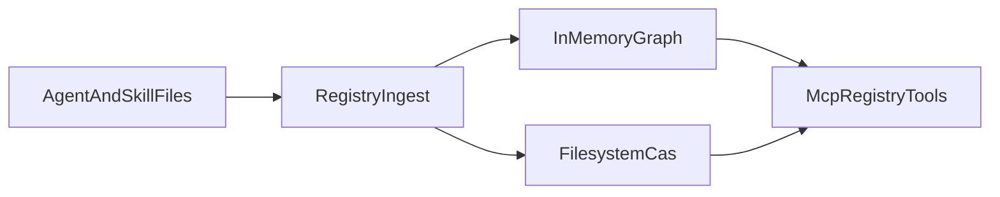

## Registry Model

This document explains the current registry model implemented under `service/registry/`.

### Core idea
The registry is split into two complementary parts:
- **graph metadata**
  - entities, aspects, and relationships
- **content-addressed artifacts**
  - raw file bytes stored by SHA-256

The intended long-term direction is:
- graph DB as the system of record for registry metadata
- CAS as the durable store for file contents

### Canonical layers
- `service/registry`
  - canonical internal registry core
  - owns registry semantics, validation direction, idempotency direction, and storage abstraction
- `service/api`
  - canonical external management plane
  - should expose registry operations and lifecycle semantics over the shared core
- `service/mcp`
  - canonical AI-facing plane
  - should consume the same shared core through thin adapters

### Main entity types
Current in-memory graph model supports:
- `AGENT`
- `AGENT_VERSION`
- `SKILL`
- `SKILL_VERSION`
- `TASK`
- `ARTIFACT`
 - `ARTIFACT_BLOB`
 - `ARTIFACT_MANIFEST`
 - `COMMIT`
 - `REF`
 - `TAG`
 - `WORKSPACE`
 - `RETENTION_ROOT`
 - `GC_JOB`
- `HARNESS`
- `TOOL`
- `PUBLIC_KEY`
- `TRANSPARENCY_LOG`
- `TRANSPARENCY_WITNESS`

These show up in the graph store as:
- nodes with `urn`, `entity_type`, and `properties`
- edges with `from_urn`, `to_urn`, `predicate`, and `properties`

### URN scheme
Current URN conventions:
- agent:
  - `urn:sg:agent:<agent_key>`
- skill:
  - `urn:sg:skill:<skill_key>`
- artifact:
  - `urn:sg:artifact:sha256:<sha256>`
- harness:
  - `urn:sg:harness:<harness_name>`
- tool:
  - `urn:sg:tool:<tool_name>`

### Relationship model
Current relationships include:
- agent defined by artifact
  - predicate: `sg:definedBy`
- agent has version
  - predicate: `sg:hasVersion`
- agent runs on harness
  - predicate: `sg:runsOn`
- agent version defined by artifact
  - predicate: `sg:definedBy`
- agent version runs on harness
  - predicate: `sg:runsOn`
- agent version uses skill
  - predicate: `sg:usesSkill`
- agent version has detached signature
  - predicate: `sg:hasDetachedSignature`
- skill implemented by artifact
  - predicate: `sg:implementedBy`
- skill has version
  - predicate: `sg:hasVersion`
- task targets skill version
  - predicate: `sg:targets`
- skill version depends on skill version
  - predicate: `sg:dependsOnVersion`
- skill version has detached signature
  - predicate: `sg:hasDetachedSignature`
- public key defined by artifact
  - predicate: `sg:definedBy`
- public key supersedes public key
  - predicate: `sg:supersedesKey`
- transparency log uses checkpoint key
  - predicate: `sg:usesCheckpointKey`
- transparency log trusted by witness
  - predicate: `sg:trustedByWitness`
- transparency witness uses key
  - predicate: `sg:usesWitnessKey`
- transparency log has checkpoint
  - predicate: `sg:hasCheckpoint`
- detached signature artifact has inclusion proof artifact
  - predicate: `sg:hasInclusionProof`
- checkpoint artifact has consistency proof
  - predicate: `sg:hasConsistencyProof`
- checkpoint artifact has witness attestation
  - predicate: `sg:hasWitnessAttestation`
- ref points to commit
  - predicate: `sg:pointsToCommit`
- tag points to commit
  - predicate: `sg:pointsToCommit`
- commit has parent commit
  - predicate: `sg:parentCommit`
- workspace based on commit
  - predicate: `sg:basedOnCommit`
- commit includes manifest
  - predicate: `sg:includesManifest`
- manifest contains blob
  - predicate: `sg:containsBlob`
- retention root keeps commit
  - predicate: `sg:keepsCommit`
- retention root keeps blob
  - predicate: `sg:keepsBlob`
- gc job analyzes retention root
  - predicate: `sg:analyzesRetentionRoot`

The `.ent` and `.rel` files under `service/registry/domain/signet/` are **spec files** describing the model. They are not the runtime database.

### Graph store today
Current runtime graph backends:
- `InMemoryGraphStore`
- `JsonFileGraphStore`
- `SparqlGraphStore`

Current documented local default:
- Fuseki-backed `sparql`

Capabilities:
- upsert node
- get node by URN
- list nodes by entity type
- upsert edge
- traverse edges from a source URN
- traverse edges to a target URN

### CAS artifact store today
Current runtime CAS store:
- `FsCasArtifactStore`
- `S3CasArtifactStore`

Behavior:
- computes SHA-256 from raw bytes
- writes the object to `objectsRootDir/<prefix2>/<sha256>`
- returns metadata such as `sha256`, `size_bytes`, and optional `media_type` / `original_path`
- recomputes the digest on every read and reports `digest_verified`; with
  `REGISTRY_ARTIFACT_INTEGRITY_MODE=enforce` a mismatch fails the read
  (`ARTIFACT_DIGEST_MISMATCH`) instead of returning tampered bytes

Example object layout:
- `data/registry/objects/ab/ab12...`

### Frozen publication envelopes today

Publishing freezes the publication envelope bytes as a CAS artifact
(`governance_role: 'publication_envelope'`, edge `sg:hasPublicationEnvelope`).
The version records `publication_envelope_artifact_urn` and
`publication_envelope_sha256`, and the envelope endpoint serves those frozen
bytes as `canonical_json`. Later evidence attachment (review, certification)
changes the live derivation, not the published payload:

- detached signatures stay valid because they cover the frozen bytes
- publication verification reports `publication_envelope_artifact_present`,
  `publication_envelope_artifact_sha256_matches`, and
  `live_envelope_matches_frozen_artifact` so drift is explicit rather than
  silently re-derived
- the envelope artifact reference is excluded from the canonical JSON and the
  canonical RDF projection (like detached signatures), so it cannot
  self-reference or shift the semantic digest

Artifact bytes are transported by `service/api` at
`GET|HEAD /v1/artifacts/{sha256}` with `Content-Digest` and
`x-artifact-digest-verified`; objects that fail their digest check are never
served (see `docs/artifact-storage.md`).

### Ingest behavior today
The current ingest flow:
1. scan roots for agent and skill files
2. read file bytes
3. write artifact bytes to the CAS
4. create an `ARTIFACT` node
5. create an `AGENT` or `SKILL` node depending on the scan root
6. create relationship edges linking entity to artifact
7. create a `HARNESS` node/edge for agents when a harness can be inferred from the path

### Important current limitation
The project now supports durable graph metadata, but the stronger semantic-governance layer is still incomplete.

Current gaps are not “no persistence” and they are no longer “no transparency checkpoint workflows”.

Implemented now already includes:
- trusted `PUBLIC_KEY`, `TRANSPARENCY_LOG`, and `TRANSPARENCY_WITNESS` trust roots
- checkpoint registration, checkpoint history, and append-only consistency validation
- witness attestations and quorum-aware checkpoint verification
- observed checkpoints, disagreement evidence, gossip events, and timeline/provenance views
- signed-note checkpoint compatibility, richer note parsing, temporal witness disagreement, and stronger provenance fields on observations and gossip
- RFC 8785 (JCS) canonical JSON for publication envelopes and governance events, with a recorded `canonicalization_algorithm` per publication and legacy fallback for pre-JCS envelopes
- publication envelope references for provenance (upstream versions and OpenLineage), revocation, and supersession
- a certification state machine for skill and agent versions (`draft`, `validated`, `rejected`, `published`, `certified`, `deprecated`, `revoked`, `archived`) with deterministic rejection, supersession guards, and certification bound to policy and ontology versions
- full agent-version lifecycle parity with skills, including dependency validation for linked skills
- a durable, non-destructive GC job execution seam over retention-root plans
- policy packages (legacy JSON shape documents and authored W3C SHACL Turtle) as versioned CAS artifacts, W3C SHACL Core execution for graph-shape + policy validation gating `draft` → `validated` (focus-scoped targeting, RE2-governed patterns), and CAS-stored violation reports linked via `sg:validatedBy`
- dual ontology packages (`registry_shape` / `skill_area`) as versioned CAS artifacts, ontology validation of `capability_claims` with de facto candidate recording, and certification bound to registered ontology packages
- PROV-O provenance edges (`prov:wasDerivedFrom`, `prov:wasGeneratedBy`, `prov:used`, `prov:wasAssociatedWith`) written at lifecycle operations, with traversal and audit-replay endpoints and a read-only MCP tool
- canonical governance events for all lifecycle operations stored as immutable CAS artifacts, an internal append-only Merkle log with RFC 6962 inclusion-proof generation, and verifier replay
- canonical RDF (RDFC-1.0) projection with semantic digests and dual (operational/semantic) detached signatures
- frozen publication envelope artifacts with digest verification on CAS reads (warn by default, `enforce` opt-in), keeping published bytes stable while later evidence is attached and reporting live drift explicitly
- DSSE/in-toto attestations as publication evidence: verified over DSSE PAE bytes against trusted keys, predicate types recorded (SLSA provenance, SPDX/CycloneDX SBOMs, scans), subjects bound to publication artifacts, stored in CAS and linked `sg:attestedBy`, surfaced in publication verification
- policy-driven publication trust gates: `require_validation` at publish, and `require_signature`, `require_trusted_publisher`, `require_build_provenance`, `require_sbom` at certification against verified signatures and attestations, plus trusted-publisher binding enforced when attaching detached signatures
- semantic compiler ingestion (markdown frontmatter + tool manifests) and a de facto vocabulary store with human-reviewed promotion into new normative ontology versions
- advisory LLM validation (heuristic default + HTTP seam) with scorecard evidence artifacts, and a human review workflow with policy-driven gating and a pending-review queue

The remaining gaps are things like:
- richer SHACL engine coverage beyond Core constraint components (SHACL-SPARQL / SHACL-AF)
- richer PROV-O coverage (JSON-LD export, canonical RDF signatures)
- deeper external Trillian/Tessera interoperability and native backend integration
- larger realistic sample-graph fixtures and persistent-backend validation packs

### Skill ingest conventions
- `AGENTS.md` under skill roots is treated as guidance, not as a skill entity definition
- file extensions currently mapped to media types:
  - `.md` -> `text/markdown`
  - `.af` -> `text/plain`
  - `.json` -> `application/json`

### Current data flow

### How MCP uses the registry today
`service/mcp` exposes registry read tools such as:
- `registry.list_agents`
- `registry.get_agent`
- `registry.list_skills`
- `registry.get_skill`
- `registry.get_artifact`

These tools currently read through adapters backed by:
- `InMemoryGraphStore`
- `FsCasArtifactStore`

### How API writes into the registry today
`service/api` now supports narrow `agents` and `skills` metadata slices with optional attached artifact content.

Current behavior:
- `POST /v1/agents` can create an `AGENT` node
- if `harness_name` is provided, it also creates a `HARNESS` node and `sg:runsOn` edge
- if `skill_refs` are provided, the API validates that the referenced skills already exist, then creates `sg:usesSkill` edges
- if an `artifact` payload is provided, it:
  - writes the bytes into the CAS
  - creates an `ARTIFACT` node
  - creates `AGENT --sg:definedBy--> ARTIFACT`
- `POST /v1/skills` can create a `SKILL` node
- if a skill `artifact` payload is provided, it:
  - writes the bytes into the CAS
  - creates an `ARTIFACT` node
  - creates `SKILL --sg:implementedBy--> ARTIFACT`

### Lifecycle management-plane model today
The first lifecycle slice is currently implemented for skills.

Core ideas:
- `SKILL` is the logical root
- `SKILL_VERSION` captures versioned management-plane state
- `TASK` captures operation execution metadata

Current version properties include fields such as:
- `version`
- `lifecycle_status`
- `active`
- `certified`
- `author`
- `created_at`
- `updated_at`
- `commit_sha`
- `git_tag`
- `artifact_signature`
- optional lineage metadata
- publication evidence fields such as:
  - `publisher`
  - `published_at`
  - `policy_version`
  - `validation_status`
  - `validation_report`
  - `canonical_json_sha256`
  - optional signature / approver references

### Agent publication model today

Agents now have a first publication-snapshot layer too.

Core ideas:
- `AGENT` is the logical root
- `AGENT_VERSION` is the immutable publication snapshot
- `AGENT.active_version_urn` points to the current active publication

Current `AGENT_VERSION` properties include fields such as:
- `version`
- `publication_status`
- `active`
- `publisher`
- `published_at`
- `policy_version`
- `validation_status`
- `validation_report`
- `canonical_json_sha256`
- optional `signature_ref`
- optional approver fields
- standard descriptive fields:
  - `display_name`
  - `description`
  - `source_path`

Current task properties include fields such as:
- `operation`
- `status`
- `author`
- `occurred_at`
- `skill_key`
- `version`
- evidence fields like commit/tag/signature/artifact sha

### Trusted public key model today

The registry now includes a first-class trusted key layer.

Core ideas:
- `PUBLIC_KEY` is the trusted key record
- PEM key bytes live in CAS as an `ARTIFACT`
- `PUBLIC_KEY --sg:definedBy--> ARTIFACT`
- detached signatures refer to trusted key material through `key_ref`

Current `PUBLIC_KEY` properties include fields such as:
- `key_ref`
- `algorithm`
- `trust_status`
- optional `owner`
- optional `trust_scope`
- optional `transparency_log_ref`
- optional `inclusion_proof_ref`
- optional `supersedes_key_ref`
- optional `superseded_by_key_ref`
- optional revocation metadata

Current trust-root lifecycle semantics:
- `trusted` keys are used for verification
- `superseded` keys remain historically visible but are no longer used as active trust roots
- `revoked` keys are no longer accepted for verification
- optional `valid_from` / `valid_to` windows constrain when a key is usable as an active trust root

### Transparency log trust model today

The registry now includes a first-class transparency log identity layer.

Core ideas:
- `TRANSPARENCY_LOG` is the trusted log identity record
- each log carries a `checkpoint_key_ref`
- `TRANSPARENCY_LOG --sg:usesCheckpointKey--> PUBLIC_KEY`
- `TRANSPARENCY_LOG --sg:trustedByWitness--> TRANSPARENCY_WITNESS`
- `TRANSPARENCY_LOG --sg:hasCheckpoint--> ARTIFACT`

Current `TRANSPARENCY_LOG` properties include fields such as:
- `log_id`
- `origin`
- `checkpoint_key_ref`
- `trust_status`
- optional `log_type`
- optional `trust_scope`
- optional `valid_from`
- optional `valid_to`
- optional `witness_quorum`

### Transparency witness model today

The registry now includes a first-class witness layer.

Core ideas:
- `TRANSPARENCY_WITNESS` is the trusted witness identity
- `TRANSPARENCY_WITNESS --sg:usesWitnessKey--> PUBLIC_KEY`
- witness attestations are stored as artifacts linked from checkpoint artifacts

Current `TRANSPARENCY_WITNESS` properties include fields such as:
- `witness_id`
- `key_ref`
- `trust_status`
- optional `witness_type`
- optional `valid_from`
- optional `valid_to`

Current verification behavior:
- publication verification recomputes canonical envelope digests
- detached signature records must point at the same envelope digest
- trusted key material is resolved from graph metadata plus CAS bytes
- detached signatures are cryptographically verified against that trusted key material
- inclusion-proof references may point to artifact-backed proof payloads
- artifact-backed proof payloads are structurally validated against:
  - the envelope digest
  - stable detached-signature claim fields
  - the detached signature artifact URN
  - the transparency-log reference when both are present
- trusted transparency log identity is resolved by `log_id`
- checkpoint signatures are cryptographically verified against the trusted checkpoint key
- Merkle inclusion proofs are verified against the checkpoint root using RFC6962-style hashing
- checkpoint history is now explicitly registerable per transparency log
- checkpoint growth beyond the current trusted checkpoint requires a consistency proof
- witness attestations are cryptographically verified against trusted witness keys
- configured witness quorum is checked in the transparency-log verification view
- externally observed checkpoints can now be ingested as first-class observations
- same-size/different-root observations are surfaced as disagreement evidence
- minimal signed-note checkpoint input is accepted and normalized into the internal checkpoint model while preserving raw note bytes
- deeper Trillian/Tessera backend compatibility and ecosystem-specific proof/witness validation are still intentionally next

### Time-aware platform model today
The first time-aware slice is implemented inside the canonical internal core.

Current platform objects:
- `COMMIT`
- `REF`
- `TAG`
- `WORKSPACE`
- `ARTIFACT_BLOB`
- `ARTIFACT_MANIFEST`
- `RETENTION_ROOT`
- `GC_JOB`

Current interpretation:
- `Commit`
  - immutable semantic state transition
- `Ref`
  - mutable pointer to a commit
- `Tag`
  - immutable named pointer to a commit
- `Workspace`
  - mutable overlay or draft area based on a commit
- `ArtifactBlob`
  - content-addressed payload unit
- `ArtifactManifest`
  - logical grouping of blobs
- `RetentionRoot`
  - object that keeps commits/blobs reachable
- `GCJob`
  - planned reachability analysis or purge workflow

Current history/navigation layer:
- `Commit` can point to one or more parent commits to form a DAG-style lineage seam
- `Commit` can include one or more artifact manifests that describe reproducible payload state
- `Ref`, `Tag`, and `Workspace` can now be queried as navigational pointers over commits
- the first retention-root analysis can explain:
  - direct commits and blobs kept by a root
  - commit ancestry retained through parent traversal
  - manifests reachable from retained commits
  - blobs reachable through those manifests
  - refs, tags, and workspaces that still point into the retained commit set

Current management-plane read surface now includes:
- list summaries for commits/refs/tags/workspaces/manifests/retention roots/gc jobs
- commit/ref/tag/workspace detail reads with resolved graph edges
- commit artifact details through `COMMIT -> ARTIFACT_MANIFEST -> ARTIFACT_BLOB`
- filtered ref/tag/workspace list queries by target/base commit
- retention-root reachability analysis across commit ancestry and commit-linked manifests/blobs
- read-only GC plan preview from a retention root
- temporal query operators:
  - `valid_at`
  - `transaction_as_of`
- draft workspace creation from a ref

Current temporal query semantics:
- commit visibility is the first temporal boundary
- `valid_at` includes commits where:
  - `valid_from <= valid_at`
  - and `valid_to` is absent or `valid_at < valid_to`
- `transaction_as_of` includes commits where:
  - `transaction_time <= transaction_as_of`
  - or `transaction_time` is absent
- ref/tag/workspace list filters use the visibility of their target or base commit
- retention-root analysis filters retained and reachable commits first, then resolves manifests and blobs from that filtered commit set
- GC plan preview uses:
  - selected-root protected sets
  - global protected sets across all retention roots in scope
  - global candidate manifests/blobs not protected by any retention root
  - blockers such as refs/tags/workspaces and overlapping retention roots
- current GC planning decision:
  - preview stays ephemeral for now
  - `GC_JOB` is now a durable management-plane seam: jobs are created and executed over HTTP (`POST /v1/time-aware/gc-jobs`, `POST /v1/time-aware/gc-jobs/:jobId/execute`), recording a non-destructive `plan_only` execution summary; physical byte reclamation remains an operator-controlled follow-up

Current limitation:
- the API now defaults to a persistent local JSON graph adapter for metadata writes
- the current local persistence layer is a development seam, not the final Jena/SPARQL-backed graph system-of-record
- CAS writes are durable and graph metadata survives API process restarts when using the JSON file backend

### Planned direction
- keep graph metadata as the source of truth
- replace or complement the in-memory graph with a persistent graph adapter
- support both a local JSON-file graph seam and an optional SPARQL/Jena-backed runtime seam
- keep SQLite operational-only for gateway concerns such as audit/auth cache
- preserve CAS as the storage mechanism for agent/skill file contents
- move duplicated agent/skill semantics out of public planes and into shared logic rooted in `service/registry`
- evolve read-only GC planning into governed GC jobs and eventually controlled purge workflows
- expose manifest-first navigation and commit creation/write semantics through a broader public time-aware management surface
- expand temporal semantics beyond commits into richer pointer/workspace lifecycle time models when the domain is ready

### Related docs
- `docs/service-map.md`
- `docs/local-development.md`
