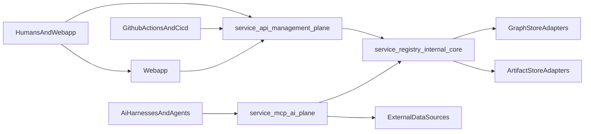

## Service Map

This document explains the intended roles of the services under `service/` in **Signet**.

### Current service layout
- `service/mcp`
- `service/registry`
- `service/api`
- `service/webapp`
- `service/shacl-runtime` (optional companion)

### Canonical boundaries
- `service/registry`
  - canonical internal registry core
  - owns validation, idempotency, versioning direction, policy direction, and storage abstraction
- `service/api`
  - canonical external management plane for humans, webapp flows, CI/CD, and automation
- `service/mcp`
  - canonical AI-facing plane
  - should remain thin and should not call `service/api` over HTTP

### `service/mcp`
Primary purpose:
- expose the current **Agent Data Access Gateway**
- provide the canonical Tool API over HTTP
- expose the same tools through the MCP adapter

Current responsibilities:
- authenticate requests
- enforce policy and SQL safety
- audit every request
- dispatch canonical tools
- expose registry read tools such as `registry.*`

Important boundaries:
- MCP must remain a thin adapter
- tool contracts are the source of truth
- business behavior belongs in application/domain layers, not in protocol glue
- MCP is not the publication authority for governance-controlled registry state

Current runtime status:
- runnable locally
- backed by `service/mcp/infra/`
- orchestrated by `infra/docker-compose.yml`

### `service/registry`
Primary purpose:
- hold the canonical internal registry domain/application layer and storage seams for:
  - graph metadata
  - content-addressed artifacts
  - ingestion logic

Current responsibilities:
- entity/relation specifications
- shared registry semantics and application logic direction
- in-memory graph store
- persistent local JSON graph store
- filesystem CAS artifact store
- ingest logic and URN conventions
- SPARQL/Jena-backed graph persistence seam

Important boundaries:
- this area is not the main user-facing HTTP runtime
- both `service/api` and `service/mcp` should consume shared registry logic rooted here
- Jena/Fuseki stays behind adapters here rather than becoming the external public contract
- governance semantics for publication, evidence, and trust belong here first before surfacing outward

Current runtime status:
- represented in local infra as a dev container/workspace seam
- not yet a standalone HTTP service

### `service/api`
Primary purpose:
- provide the canonical external management plane for registry entities and lifecycle operations
- support CICD, GitHub Actions, scanners, CLIs, and other machine clients

Current responsibilities:
- expose a bootstrap HTTP runtime with health endpoints
- expose a machine-readable boundary descriptor at `GET /v1`
- expose the first versioned `agents` metadata HTTP contracts:
  - `GET /v1/agents`
  - `GET /v1/agents/:agentKey`
  - `POST /v1/agents`
- expose the first versioned `skills` metadata HTTP contracts:
  - `GET /v1/skills`
  - `GET /v1/skills/:skillKey`
  - `POST /v1/skills`
- expose the full lifecycle management plane for skills and agents:
  - draft, validate, publish, promote, deprecate, certify, revoke, archive, review
  - deterministic draft rejection and certification bound to policy/ontology versions
  - resolve active version
  - publication envelopes, detached signatures, and verification
  - provenance traversal and audit replay (`GET .../versions/:v/provenance`)
- expose the first time-aware management-plane operations:
  - list commits/refs/tags/workspaces/manifests/retention roots/gc jobs
  - read commit/ref/tag/workspace navigation details
  - resolve commit-attached manifests and blobs
  - filter refs/tags/workspaces by target/base commit
  - apply `valid_at` and `transaction_as_of` query operators over commit-backed time-aware reads
  - analyze retention-root reachability across commit ancestry and artifact manifests
  - preview read-only GC planning sets and blockers from a retention root
  - create and execute durable, non-destructive GC jobs (`POST /v1/time-aware/gc-jobs`, `POST /v1/time-aware/gc-jobs/:jobId/execute`)
  - create draft workspace from ref
- expose the current trust/transparency management-plane operations:
  - trusted public-key create/read/revoke flows
  - transparency log and witness registration
  - transparency checkpoint registration with consistency-proof and witness-attestation support
  - transparency checkpoint observations and gossip events
  - transparency verification and timeline inspection
- expose the semantic-governance management-plane operations:
  - policy packages — legacy JSON and authored W3C SHACL Turtle (`/v1/policy-packages`)
  - dual ontology packages (`/v1/ontology-packages`)
  - semantic compiler ingestion (`POST /v1/compile/skill`)
  - de facto vocabulary queue (`/v1/de-facto-terms*`)
  - human review (`POST .../versions/:v/review`, `GET /v1/reviews/pending`)
  - internal governance Merkle log (`/v1/governance-log*`)
- enforce auth on write routes and persist audit/auth state for those writes

Planned responsibilities:
- deterministic management and lifecycle operations over registry content
- programmatic workflows outside MCP harness use cases
- future integration surface for non-agent system clients

Important boundaries:
- this API is distinct from `service/mcp`
- `service/api` is for management-plane and operational integrations
- `service/mcp` is for tool-based agent access
- `service/api` should call shared registry logic directly, not become a storage facade over Jena
- `service/api` is the canonical write/publication authority for governed registry changes

### `service/webapp`
Primary purpose:
- provide human-facing registry browsing and operational launchpad UX
- consume `service/api` as the canonical management-plane surface
- optionally deep-link or lightly integrate with external ontology-authoring tools such as VocBench / Semantic Turkey

Current responsibilities:
- thin human UI over registry metadata
- first-value pages for agents, skills, and ontology project status
- companion integration path for knowledge-authoring tooling

Important boundaries:
- `service/webapp` is not the canonical management plane
- it should consume `service/api`, not `service/registry` directly
- ontology authoring authority, when present, stays outside this repo UI unless explicitly brought in later
- Okta/browser auth alignment currently applies to the registry-admin surface over `service/api`, not to the Semantic Turkey / VocBench companion runtime

Current runtime status:
- runnable locally
- backed by `service/api/infra/`
- orchestrated by `infra/docker-compose.yml`
- defaults to a persistent local graph file for API metadata writes
- currently keeps ontology access/auth as a separate companion concern rather than a unified identity surface

### `service/shacl-runtime` (optional companion)
Primary purpose:
- execute authored SHACL shapes with advanced features — SHACL-AF rules, SPARQL functions, and custom SPARQL-based constraint components — that no in-process engine implements

Current responsibilities:
- validate PREPARED shapes and N-Quads datasets on `POST /v1/validate` (pyshacl, `advanced=True`) and return deterministic, spec-shaped results
- run every validation in an rlimit-bounded worker subprocess with hard-kill timeouts (forkserver-preloaded workers; `/healthz` reports worker stats)
- refuse federated queries (`SERVICE`) and `REGEX(` as defense in depth (the registry's RE2 layer owns regex)

Important boundaries:
- optional: when it is not configured, the registry fails closed on policies using SHACL-AF constructs — never a silent conform
- receives prepared shapes only (targeting rewritten to focus nodes, `sh:pattern` stripped)
- not a write plane: it evaluates and reports, nothing else

Current runtime status:
- runnable locally via `infra/docker-compose.yml` (profile `shacl-af`)
- deployable from `charts/signet` via the `shaclRuntime` option
- wired into `service/api` through `SHACL_RUNTIME_URL` / `SHACL_RUNTIME_TOKEN`

### Relationship between services

### Practical rule of thumb
- Need tool-based agent access or MCP compatibility? Use `service/mcp`.
- Need canonical internal registry logic or storage adapters? Work in `service/registry`.
- Need management-plane machine integration? Use `service/api`.

### Related docs
- `docs/local-development.md`
- `docs/registry-model.md`
- `service/mcp/README.md`
- `service/api/README.md`
- `service/api/AGENTS.md`
