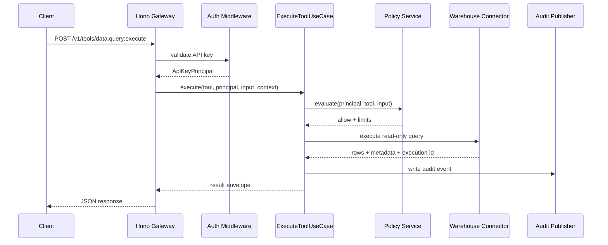
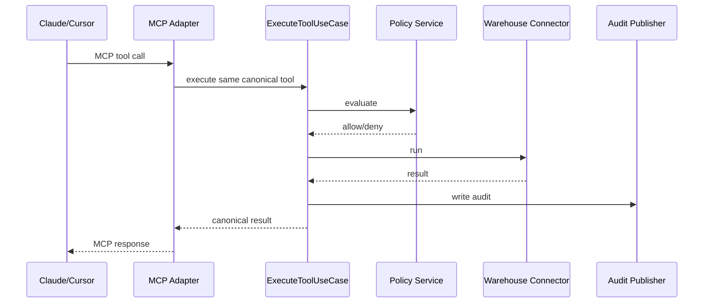
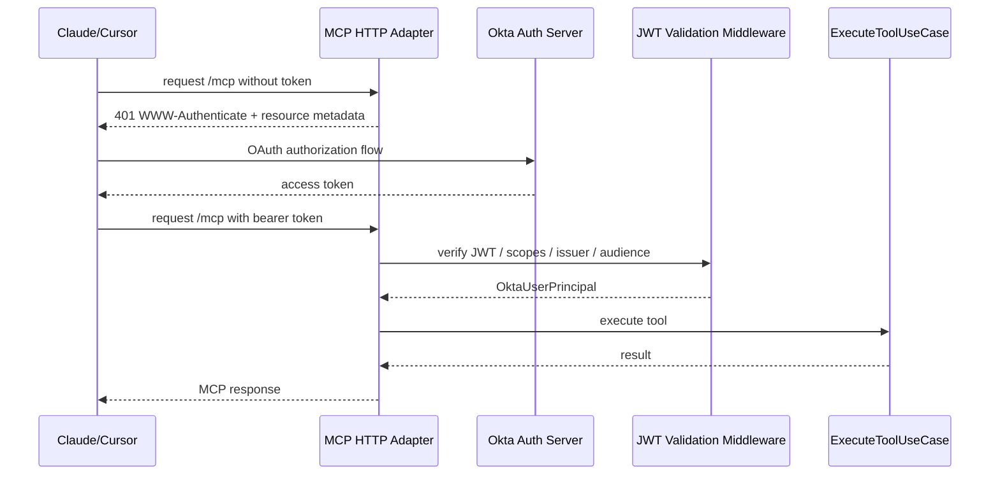

# Agent Data Access Gateway — Platform Architecture Specification

## 1. Purpose
This document is the implementation architecture spec for the first production version of the agent data access layer.

It is written for:
- Principal / Staff engineers
- Eng managers / TPMs
- backend ICs
- platform / infra engineers
- security reviewers

The architecture goal is simple:

> Build one clean internal Tool Platform first; expose MCP as a thin protocol adapter, not as the place where business logic lives.

---

## 2. Product scope

### Stage 1
- Clients: **Claude Code** and **Cursor**
- Protocol: **Remote MCP over HTTP**
- Data sources:
  - Snowflake
  - Athena
  - MotherDuck
- Tools:
  - `data.query`
  - `data.list_tables`
  - `data.describe_table`
- Access model:
  - opaque API key bearer token
- Operations:
  - read-only only
- Required control:
  - auditability of every call

### Stage 2
- Keep all of the above stable
- Add:
  - Okta OAuth access tokens
  - per-user authorization based on Okta claims/groups/scopes
  - MCP OAuth resource behavior for remote clients

---

## 3. Architectural principles

### 3.1 MCP is an adapter
The MCP layer:
- exposes tools to clients
- validates/normalizes inbound MCP requests
- delegates into the same application layer used by the internal Tool API
- transforms the application response into an MCP-compliant response

The MCP layer **must not**:
- contain SQL policy logic
- talk directly to Snowflake/Athena/MotherDuck
- own authorization decisions
- own canonical tool schemas

### 3.2 The Tool API is the canonical contract
The Tool API is the stable center of gravity:
- `GET /v1/tools`
- `POST /v1/tools/{toolName}:execute`

Both:
- Hono routes
- MCP tool definitions

must derive from the same registry and same schemas.

### 3.3 Authentication at ingress; authorization in use cases
Authentication happens at Hono middleware.
Authorization happens inside application services / policy services.

This makes:
- direct Tool API calls
- MCP calls
- future adapters

all go through one policy and audit path.

### 3.4 Read-only safety over query cleverness
In Stage 1, safety beats SQL flexibility.
A conservative validator is preferable to a “smart” validator that accidentally permits dangerous statements.

### 3.5 Audit is a product feature, not a side effect
Every tool execution produces a first-class audit event:
- allow
- deny
- success
- failure

---

## 4. Runtime and deployment model

## 4.1 Runtime
- Node.js 20 LTS or 22 LTS
- TypeScript ESM or consistent NodeNext setup
- Hono running on Node via `@hono/node-server`

### Why not edge?
Because the connector libraries are Node-native and the process needs:
- DB/network access
- OTel instrumentation
- richer connection handling
- DuckDB native bindings for MotherDuck examples

## 4.2 Deployment topology (v1)
One deployable service:

```text
┌────────────────────────────────────────────────────────────┐
│ Agent Data Access Gateway                                 │
│                                                            │
│  Hono HTTP server                                          │
│  ├── MCP HTTP adapter (/mcp)                               │
│  ├── Tool API (/v1/tools, /v1/tools/:name:execute)         │
│  ├── Health/ready endpoints                                │
│  ├── Auth middleware                                       │
│  ├── Request ID / logging / OTel                           │
│  ├── Tool execution application layer                      │
│  ├── Policy service                                        │
│  ├── Audit publisher                                       │
│  └── Warehouse connectors                                  │
│      ├── Snowflake                                         │
│      ├── Athena                                            │
│      └── MotherDuck                                        │
└────────────────────────────────────────────────────────────┘
```

Optional external infrastructure:
- load balancer
- reverse proxy / API gateway
- observability backend
- database for audit persistence
- secrets manager

---

## 5. Bounded contexts (DDD)

## 5.1 Auth Context
Responsibilities:
- parse inbound bearer credential
- validate Stage 1 API key or Stage 2 Okta access token
- produce `Principal`

Does not:
- decide which tool is allowed
- understand SQL objects

Core domain object:
- `Principal`
  - `type`: `api_key | okta_user`
  - `id`
  - `displayName`
  - `scopes`
  - `groups`
  - `claims`
  - `authMethod`

## 5.2 Tool Registry Context
Responsibilities:
- register canonical tools
- hold names, descriptions, schemas, risk tier, version
- provide discovery for Tool API and MCP adapter

Core domain object:
- `ToolDefinition`

## 5.3 Tool Execution Context
Responsibilities:
- validate input
- authorize call
- execute tool
- shape result
- publish audit
- map domain errors to response errors

Core domain object:
- `ToolExecution`

## 5.4 Policy Context
Responsibilities:
- translate principal + tool + target objects + data source into allow/deny
- enforce limits
- explain policy decision for audit

Core domain object:
- `PolicyDecision`
  - `effect`: `allow | deny`
  - `reason`
  - `limits`
  - `matchedRules`

## 5.5 Connector Context
Responsibilities:
- implement warehouse-specific interactions
- return normalized metadata / rows / execution ids
- never decide authorization

Core domain object:
- `WarehouseExecutionResult`

## 5.6 Audit Context
Responsibilities:
- create immutable audit events
- persist to DB + log stream
- expose query path for operational review if desired

Core domain object:
- `AuditEvent`

## 5.7 MCP Adapter Context
Responsibilities:
- expose tools to MCP clients
- convert app-level schemas and responses into MCP constructs

Does not:
- own business policy
- own business validation rules beyond transport normalization

---

## 6. Request flows

## 6.1 Stage 1 — Tool API call


## 6.2 Stage 1 — MCP tool call


## 6.3 Stage 2 — MCP OAuth path


---

## 7. Canonical interfaces

## 7.1 Tool API
### List tools
`GET /v1/tools`

Response:
```json
{
  "tools": [
    {
      "name": "data.query",
      "version": "1.0.0",
      "description": "Run a read-only SQL query against an approved data source.",
      "risk_tier": "READ_ONLY",
      "input_schema": {},
      "output_schema": {}
    }
  ]
}
```

### Execute tool
`POST /v1/tools/{toolName}:execute`

Response envelope:
```json
{
  "audit_id": "uuid",
  "decision": {
    "effect": "allow",
    "reason": "matched rule read_only_query",
    "limits_applied": {
      "max_rows": 50,
      "timeout_ms": 15000,
      "max_output_bytes": 65536
    }
  },
  "result": {},
  "error": null
}
```

## 7.2 Tool definitions
Canonical tools:

### `data.query`
Input:
- `data_source`
- `sql`
- `max_rows?`
- `timeout_ms?`

Output:
- `columns`
- `rows`
- `row_count_returned`
- `truncated`
- `warehouse_execution_id?`
- `stats?`

### `data.list_tables`
Input:
- `data_source`
- `database?`
- `schema?`
- `pattern?`
- `limit?`

### `data.describe_table`
Input:
- `data_source`
- `database`
- `schema`
- `table`

---

## 8. Validation and contract strategy

## 8.1 Single source of truth = Zod
Each tool has:
- input schema in Zod
- output schema in Zod

Use those schemas for:
- Hono validation
- internal use case validation
- MCP registration
- contract tests
- schema snapshot docs

## 8.2 Validation layers
1. **Ingress validation**
   - request JSON shape
   - field types
2. **Policy validation**
   - tool allowed?
   - data source allowed?
   - SQL safe?
3. **Connector validation**
   - connector-specific invariants
4. **Output shaping**
   - truncate
   - sanitize
   - enforce size caps

---

## 9. Authentication and authorization design

## 9.1 Stage 1 auth
- Opaque bearer API keys
- hashed at rest
- principal derived from API key record

Minimum key record:
- `key_id`
- `key_hash`
- `owner_label`
- `created_at`
- `revoked_at`

Recommended token format:
- Prefix a stable key id for easier lookup and rotation
- Example: `agk_<public_id>_<secret_material>`
- Persist only:
  - public id
  - hash(secret material or full token depending on lookup design)

## 9.2 Stage 2 auth
Use **Okta custom authorization server**.

Why custom auth server:
- Okta docs distinguish org auth server tokens from tokens intended for your own APIs
- your service is a resource server, so use a custom auth server and validate access tokens

Minimum token checks:
- signature
- issuer
- audience
- expiration / not-before
- scopes

Recommended scopes:
- `data.query.read`
- `data.catalog.read`

Recommended claims:
- `groups`
- `email`
- optional `preferred_username`
- optional dedicated entitlement claim if already modeled in Okta

## 9.3 Authorization placement
Authorization must stay in the application layer.

Policy input:
- principal
- tool
- data source
- target objects (if known)
- risk tier
- request context

Policy output:
- allow/deny
- reason
- enforced limits
- matched rule ids

---

## 10. SQL safety model

## 10.1 Stage 1
Conservative validator:
- one statement only
- no semicolon-separated chains
- must be `SELECT` or `WITH ... SELECT`
- deny obvious mutating / admin keywords:
  - `INSERT`
  - `UPDATE`
  - `DELETE`
  - `MERGE`
  - `COPY`
  - `UNLOAD`
  - `CREATE`
  - `ALTER`
  - `DROP`
  - `TRUNCATE`
  - `GRANT`
  - `REVOKE`
  - `CALL`
  - `PUT`
  - `GET`
  - `USE`
  - `SET`

Recommendation:
- Start with a lexical + statement-count validator
- Do not try to support every dialect nuance in Stage 1
- Fail closed

## 10.2 Stage 2
Add object extraction so authorization can enforce schema/table patterns from Okta-derived entitlements.

This may justify introducing a dedicated SQL parser library in Stage 2, not Stage 1.

---

## 11. Output shaping model

Large tool results are dangerous for:
- agent context windows
- cost
- latency
- accidental leakage

Claude Code explicitly warns on large MCP outputs.

### Required limits
- `max_rows` default 50
- hard max 500
- `timeout_ms` default 15000
- hard max 60000
- `max_output_bytes` default 65536
- absolute response ceiling per tool result

### Result shaping rules
- include column names
- include up to `max_rows`
- set `truncated=true` when rows were cut
- include `row_count_returned`
- optionally include a short advisory string:
  - “result truncated to 50 rows”

---

## 12. Observability specification

## 12.1 Request IDs
Use Hono request ID middleware and propagate `request_id` in:
- logs
- audit events
- error responses where safe
- downstream connector logs

## 12.2 Tracing
Use OpenTelemetry Node SDK.
Instrument:
- inbound HTTP
- outbound AWS SDK calls
- SQL execution spans
- audit persistence spans

Recommended span names:
- `tool.execute`
- `policy.evaluate`
- `warehouse.snowflake.query`
- `warehouse.athena.query`
- `warehouse.motherduck.query`
- `audit.publish`

## 12.3 Logging
Use Pino JSON logs.

Rules:
- never log raw authorization header
- never log API keys / bearer tokens / cookies
- never bind raw request objects as persistent child logger state
- log curated fields only

Recommended base fields:
- `service`
- `environment`
- `request_id`
- `trace_id`
- `span_id`
- `principal_id`
- `tool_name`
- `data_source`

## 12.4 Audit
Audit is not just logs.

Persist immutable events to a queryable store with at least:
- `audit_id`
- `request_id`
- `principal_id`
- `client_name`
- `tool_name`
- `tool_version`
- `data_source`
- `input_sha256`
- `input_preview_redacted`
- `policy_effect`
- `policy_reason`
- `latency_ms`
- `rows_returned`
- `truncated`
- `warehouse_execution_id`
- `error_code`
- `occurred_at`

---

## 13. Error model

### Principles
- stable machine-readable codes
- safe human-readable messages
- preserve internal detail in logs, not client responses

### Error categories
- `AUTH_UNAUTHENTICATED`
- `AUTH_FORBIDDEN`
- `TOOL_NOT_FOUND`
- `VALIDATION_ERROR`
- `SQL_NOT_READ_ONLY`
- `CONNECTOR_TIMEOUT`
- `CONNECTOR_UNAVAILABLE`
- `RESULT_TOO_LARGE`
- `INTERNAL_ERROR`

### Response shape
```json
{
  "audit_id": "uuid",
  "decision": {
    "effect": "deny",
    "reason": "sql_not_read_only"
  },
  "result": null,
  "error": {
    "code": "SQL_NOT_READ_ONLY",
    "message": "Only single-statement read-only queries are allowed."
  }
}
```

---

## 14. Folder structure recommendation

```text
src/
  app/
    server.ts
    routes/
      health.ts
      tools.ts
      mcp.ts
    middleware/
      request-id.ts
      auth-api-key.ts
      auth-okta.ts
      logger.ts
      errors.ts
  application/
    usecases/
      execute-tool.ts
      list-tools.ts
    ports/
      audit-publisher.ts
      warehouse-connector.ts
      policy-service.ts
      principal-resolver.ts
  domain/
    tools/
      tool-definition.ts
      tool-registry.ts
      tool-names.ts
    policy/
      policy-decision.ts
      policy-rules.ts
    audit/
      audit-event.ts
    principal/
      principal.ts
    sql/
      validation.ts
      object-extraction.ts
  infrastructure/
    config/
      env.ts
    logging/
      pino.ts
    telemetry/
      instrumentation.ts
    auth/
      api-key-store.ts
      okta-verifier.ts
    connectors/
      snowflake/
      athena/
      motherduck/
    audit/
      audit-repository.ts
    mcp/
      server.ts
      tool-registration.ts
  tests/
    unit/
    integration/
    contract/
    smoke/
```

---

## 15. Configuration model

Environment variables:

### Core
- `NODE_ENV`
- `PORT`
- `LOG_LEVEL`
- `MAX_ROWS_DEFAULT`
- `MAX_ROWS_HARD_MAX`
- `TOOL_TIMEOUT_MS_DEFAULT`
- `TOOL_TIMEOUT_MS_HARD_MAX`
- `MAX_OUTPUT_BYTES`

### Audit DB
- `DATABASE_URL`

### Snowflake
- `SNOWFLAKE_ACCOUNT`
- `SNOWFLAKE_USERNAME`
- `SNOWFLAKE_PASSWORD` or key pair settings
- `SNOWFLAKE_WAREHOUSE`
- `SNOWFLAKE_DATABASE`
- `SNOWFLAKE_SCHEMA`
- `SNOWFLAKE_ROLE`

### Athena
- `AWS_REGION`
- standard AWS credentials via SDK v3 provider chain
- `ATHENA_WORKGROUP`
- `ATHENA_OUTPUT_S3`

### MotherDuck
- `MOTHERDUCK_TOKEN`
- `MOTHERDUCK_DATABASE`

### Stage 2 / Okta
- `OKTA_ISSUER`
- `OKTA_AUDIENCE`
- `OKTA_REQUIRED_SCOPES`
- `OKTA_GROUPS_CLAIM` (default `groups`)

---

## 16. Client onboarding model

## 16.1 Stage 1 — Claude Code
Use remote HTTP MCP and bearer header.
Reference:
- https://code.claude.com/docs/en/mcp

Example:
```bash
claude mcp add \
  --transport http \
  company-data \
  https://agent-data.example.com/mcp \
  --header "Authorization: Bearer <stage1-api-key>" \
  --header "X-Agent-Client: claude-code"
```

## 16.2 Stage 1 — Cursor
Use remote MCP configuration with headers.
Reference:
- https://docs.cursor.com/en/context/mcp

Recommended additional header:
- `X-Agent-Client: cursor`

## 16.3 Stage 2 — OAuth
Keep the MCP endpoint stable (`/mcp`).
Implement the OAuth-facing behavior server-side so the client can complete its login flow without new tool contracts.

---

## 17. Quality gates

### Before Stage 1 production
- contract tests for tool registry
- unit tests for SQL validator
- integration tests for each connector
- MCP smoke test
- Claude Code manual smoke
- Cursor manual smoke
- audit record verification for allow and deny flows

### Before Stage 2 production
- all JWT validation negative/positive tests
- resource metadata endpoint validation
- `WWW-Authenticate` challenge validation
- staging auth flow from Claude Code
- staging auth flow from Cursor
- authorization tests using multiple Okta group combinations

---

## 18. Risks and mitigations

### Risk: MCP client compatibility drift
Mitigation:
- keep MCP thin
- keep Tool API canonical
- maintain manual smoke checklist per release

### Risk: Stage 1 SQL validator is too strict
Mitigation:
- fail closed first
- capture denied attempts
- expand deliberately based on real usage

### Risk: “Agent can only do what the human can do” is underspecified
Mitigation:
- Stage 2 minimal truth is Okta group/claim-derived policy
- document that stronger maturity later may use warehouse-native impersonation/role mapping

### Risk: Athena data leakage via S3 result bucket
Mitigation:
- dedicated output bucket/prefix
- strict IAM and bucket policy review
- treat bucket permissions as part of the security design

---

## 19. References
- Claude Code MCP: https://code.claude.com/docs/en/mcp
- Cursor MCP: https://docs.cursor.com/en/context/mcp
- MCP TypeScript SDK: https://github.com/modelcontextprotocol/typescript-sdk
- MCP auth spec: https://modelcontextprotocol.io/specification/2025-03-26/basic/authorization
- Hono docs: https://hono.dev/
- Zod: https://zod.dev/
- OpenTelemetry JS: https://opentelemetry.io/docs/languages/js/
- Pino: https://github.com/pinojs/pino
- Okta auth servers: https://developer.okta.com/docs/concepts/auth-servers/
- Okta access token validation: https://developer.okta.com/docs/guides/validate-access-tokens/nodejs/main/
- Snowflake Node.js driver: https://docs.snowflake.com/en/developer-guide/node-js/nodejs-driver
- Athena APIs: https://docs.aws.amazon.com/athena/latest/APIReference/Welcome.html
- MotherDuck Node connection docs: https://motherduck.com/docs/key-tasks/authenticating-and-connecting-to-motherduck/connecting-to-motherduck/
