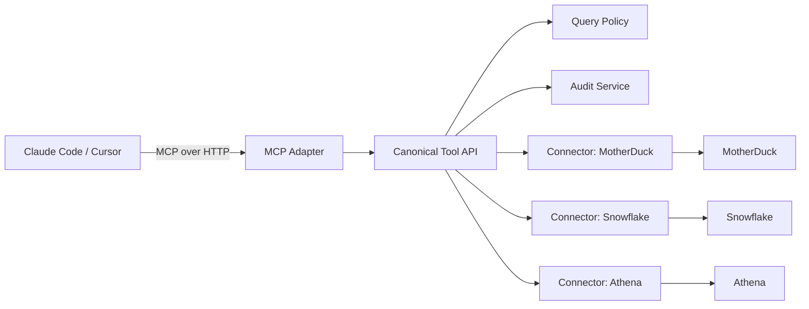

# Agent Data Access Layer — Product Definition

**Status:** Draft for implementation  
**Audience:** Product, Engineering, Security, Data Platform  
**Document intent:** Give the team a crisp product definition and an architecture shape that ships fast now and avoids a later rewrite.

---

## 1. Executive summary

We are building a company-internal **Agent Data Access Layer** that lets approved humans use **Claude Code** and **Cursor** to access company data in **MotherDuck, Snowflake, and Athena** through **MCP**, while keeping the system **read-only**, **auditable**, and architected for a later move to **Okta-backed human-scoped authorization**.

The core architecture decision is:

> **MCP is the external adapter. The canonical product surface is an internal Tool API.**

This means we do **not** put source access logic, authorization logic, or audit logic inside the MCP server. The MCP layer only translates MCP tool calls into calls to the canonical internal Tool API.

That gives us four big wins:

1. **Fast time to value now** for Cursor and Claude Code.
2. **Clean security boundaries** and one place to enforce read-only rules.
3. **Stable contracts** for future clients, even if MCP client behavior changes.
4. **No heavy refactor later** when we add Okta or expose the same tools through a second interface.

---

## 2. Problem statement

Today, AI agents can reach data through ad hoc scripts, direct warehouse credentials, or one-off integrations. That creates the usual problems:

- access patterns are inconsistent across tools and warehouses
- audit trails are fragmented or missing
- security controls drift by client and by connector
- direct warehouse access from agent clients does not leave a clean seam for future identity controls
- every new agent client risks another integration path

We want one company-owned access layer that:

- standardizes how agents discover and query data
- constrains access to a safe, read-only tool surface
- records exactly **who used which agent, which tool, against which source, when, and with what result**
- can later authenticate the agent as the **human user via Okta OAuth**, so the agent only sees what the human can see

---

## 3. Product vision

A single company-owned agent data access layer that:

- works across our approved agent clients
- presents a small, stable, tool-oriented interface
- abstracts source-specific details behind connectors
- treats auditability and access control as first-class product features
- can evolve from simple named tokens to human-scoped Okta OAuth without changing tool contracts

---

## 4. Users and stakeholders

### Primary users
- **Data platform stakeholders** who want to query and inspect company data from **Claude Code** and **Cursor**.
- **Engineers and analysts** who need safe, read-only access to multiple data platforms from their AI workflows.

### Secondary stakeholders
- **Security and identity teams** who need clear ownership, least privilege, and auditable activity.
- **Engineering managers / platform owners** who need maintainability and a clean long-term architecture.
- **Compliance / governance partners** who need a reliable audit trail.

---

## 5. Jobs to be done

### User jobs
1. From Claude Code or Cursor, I can discover available company data sources.
2. I can inspect schemas, tables, and columns before running a query.
3. I can execute **read-only** SQL against approved data sources.
4. I can get bounded, agent-safe results instead of huge unstructured dumps.

### Platform jobs
1. We can see every tool call and every resulting source query.
2. We can answer: **who**, **which client**, **which tool**, **which source**, **which query**, **which outcome**.
3. We can enforce read-only behavior consistently across all sources.
4. We can swap Stage 1 token auth for Stage 2 Okta user auth without redesigning the product.

### Security jobs
1. No anonymous production access.
2. No write-capable SQL.
3. No source credentials embedded directly in agent prompts or chat history.
4. No business logic hidden inside the MCP adapter.

---

## 6. Scope

## Stage 1 — deliver value quickly
**Goal:** Enable read-only access to MotherDuck, Snowflake, and Athena from Claude Code and Cursor through MCP, with full auditability of agent actions.

### Stage 1 in scope
- remote MCP endpoint for approved clients
- thin MCP adapter over canonical internal Tool API
- read-only metadata and query tools
- connectors for MotherDuck, Snowflake, Athena
- named user tokens or equivalent minimal auth for audit attribution
- append-only audit logging for every tool invocation and source query
- bounded results, timeouts, row limits, and query validation

### Stage 1 out of scope
- write operations
- notebook / BI tool integrations
- semantic layer, metric layer, or natural-language-to-SQL orchestration inside the gateway
- fine-grained human entitlement enforcement from Okta
- policy-admin UI
- downstream impersonation of warehouse user identities

## Stage 2 — add human-scoped Okta control
**Goal:** Add Okta OAuth of the human user so the agent can only do what that human is allowed to do according to Okta.

### Stage 2 in scope
- Okta-backed OAuth for MCP access
- principal propagation through the Tool API
- policy decisions inside the Tool API based on Okta user identity / claims / groups
- audit trail with true human identity
- migration away from Stage 1 personal tokens

### Stage 2 out of scope
- write operations
- broad policy marketplace / request workflow UI
- cross-client expansion beyond approved clients unless explicitly added
- per-vendor downstream impersonation unless it is cheap and clearly valuable

---

## 7. Product principles

### 7.1 Thin adapter, thick core
The MCP adapter should only:
- speak MCP
- expose tool definitions
- translate tool calls to the Tool API
- map Tool API errors back to MCP errors
- pass through request context

The MCP adapter should **not**:
- contain business rules
- enforce source-specific authorization
- build SQL safety policy
- implement connector logic
- own audit persistence

### 7.2 Modular monolith first
Do **not** start with multiple distributed services.

For Stage 1 and likely Stage 2, build a **modular monolith** with clean boundaries:

- one deployable
- one codebase
- clear modules by domain / bounded context
- separate adapters at the edges

This gives us architecture discipline without distributed systems tax.

### 7.3 Contract-first tool design
Tool contracts are product surface. Tool names, schemas, errors, and audit semantics are versioned and treated as stable.

### 7.4 Read-only by multiple defenses
Read-only is not one check. It is enforced by:
1. tool surface
2. SQL validator
3. source credentials / roles
4. result limits
5. auditability

### 7.5 Audit is part of the product
Audit logs are not “nice to have telemetry.” They are a core feature and a release gate.

### 7.6 Keep outputs small
Agent clients do better with bounded, structured output than with giant dumps. Favor:
- limited rows
- summarized metadata
- explicit truncation flags
- pagination in later maturity

### 7.7 Do not normalize away all vendor differences
The Tool API should present a canonical shape for metadata and execution, but we should **not** pretend all SQL dialects are the same. Queries remain source-native SQL.

---

## 8. Architecture decision

## Decision
Build a **remote HTTP MCP endpoint** that fronts a **canonical internal Tool API**. Prefer **HTTP** transport for remote MCP. Keep the whole system as a **modular monolith** first.

### Why this shape
- It works with our immediate clients.
- It keeps the long-lived contract in our control.
- It is compatible with Stage 2 OAuth and policy work.
- It lets us add a second front door later without changing source logic.

### Physical shape in Stage 1
One deployable exposes:
- `POST /mcp` (or equivalent MCP endpoint)
- `POST /internal/tool-invocations` (internal, future-proof, not public product surface)

The MCP adapter may call the Tool API **in-process** or through loopback HTTP in the same deployable. The architectural seam matters more than the network hop.

### What must never happen
- warehouse access logic implemented directly in the MCP layer
- authorization duplicated in each connector
- a separate microservice per source before we have evidence we need that

---

## 9. High-level architecture



### Layer responsibilities

| Layer | Responsibilities | Must not do |
|---|---|---|
| MCP Adapter | MCP protocol handling, tool registration, request translation, auth challenge passthrough | SQL safety, source authZ, source access, audit persistence |
| Tool API / Application Layer | canonical tool invocation, policy entry point, validation orchestration, audit orchestration | protocol-specific client logic |
| Query Policy | read-only validation, result bounds, source/tool allow checks | direct transport handling |
| Connectors | vendor-specific metadata + query execution via clean interfaces | product policy decisions |
| Audit | append-only audit events, trace correlation, searchable history | business routing |
| Identity & Policy (Stage 2) | Okta token validation, principal resolution, access decisions | connector implementation |

---

## 10. Domain-driven design model

## Bounded contexts

### 10.1 Agent Access Context
Owns MCP-facing concepts:
- MCP Server
- MCP Tool Definition
- MCP Session
- Client Context (`cursor`, `claude_code`)

### 10.2 Tool Catalog Context
Owns canonical tool contracts:
- `ToolDefinition`
- `ToolVersion`
- `ToolInputSchema`
- `ToolOutputSchema`
- `ToolRiskLevel`
- `ToolOwner`

### 10.3 Query Execution Context
Owns the use cases:
- `ListSources`
- `ListNamespaces`
- `ListRelations`
- `DescribeRelation`
- `PreviewRelation`
- `ExecuteReadonlySql`

Core aggregates / value objects:
- `SourceId`
- `NamespaceRef`
- `RelationRef`
- `ReadonlySql`
- `ExecutionLimits`
- `QueryFingerprint`

### 10.4 Connector Context
Owns source-specific adaptation:
- `Connector`
- `ConnectorCapabilities`
- `ConnectorSession`
- `SourceExecutionId`

This is the anti-corruption layer for vendor semantics.

### 10.5 Audit Context
Owns durable traceability:
- `ToolInvocationAuditEvent`
- `SourceQueryAuditEvent`
- `PolicyDecisionAuditEvent`
- `CorrelationId`
- `ActorId`
- `Outcome`

### 10.6 Identity & Policy Context (Stage 2)
Owns identity and authorization:
- `Principal`
- `PrincipalClaims`
- `AccessProfile`
- `PolicyDecision`
- `DeniedReason`

## Domain invariants
1. Every production tool invocation has a principal, client, tool name, correlation id, and timestamp.
2. Every query execution attempt is audited, including denials and failures.
3. `ExecuteReadonlySql` only accepts validated, single-statement, read-only SQL.
4. Connectors only execute with read-only source permissions.
5. Tool schemas are versioned and backward compatible within a major version.

---

## 11. Canonical Tool API

## Invocation pattern

### Request envelope
```json
{
  "tool_name": "query.execute_readonly_sql",
  "tool_version": "1.0",
  "principal": {
    "id": "user-123",
    "type": "human",
    "display_name": "Jane Doe"
  },
  "client": {
    "name": "cursor",
    "session_id": "sess-abc",
    "project_id": "repo-or-workspace"
  },
  "input": {},
  "trace": {
    "correlation_id": "corr-123"
  }
}
```

### Response envelope
```json
{
  "status": "succeeded",
  "audit_ref": "audit-123",
  "warnings": [],
  "output": {},
  "metrics": {
    "elapsed_ms": 231
  }
}
```

## Tool set

### Stage 1 v1 required tools

#### `platform.list_sources`
Returns the data sources the caller can see.

**Input**
```json
{}
```

**Output**
```json
{
  "sources": [
    {
      "source_id": "snowflake-prod",
      "source_type": "snowflake",
      "display_name": "Snowflake Prod",
      "capabilities": ["metadata", "readonly_sql"]
    }
  ]
}
```

#### `metadata.list_namespaces`
Lists catalogs / databases / schemas in a canonical hierarchy.

**Input**
```json
{
  "source_id": "snowflake-prod",
  "parent": {
    "kind": "catalog",
    "name": "ANALYTICS"
  }
}
```

#### `metadata.list_relations`
Lists tables / views inside a namespace.

**Input**
```json
{
  "source_id": "athena-prod",
  "namespace": {
    "catalog": "AwsDataCatalog",
    "schema": "analytics"
  }
}
```

#### `metadata.describe_relation`
Returns columns and structural metadata.

**Input**
```json
{
  "source_id": "motherduck-prod",
  "relation": {
    "catalog": "main",
    "schema": "analytics",
    "name": "orders"
  }
}
```

#### `query.execute_readonly_sql`
Executes a validated, bounded, read-only SQL statement in the source’s native dialect.

**Input**
```json
{
  "source_id": "snowflake-prod",
  "sql": "select * from analytics.orders limit 50",
  "max_rows": 50
}
```

**Output**
```json
{
  "columns": [
    {"name": "order_id", "type": "VARCHAR"}
  ],
  "rows": [
    ["o_123"]
  ],
  "row_count_returned": 1,
  "truncated": false,
  "source_execution_id": "src-123",
  "stats": {
    "elapsed_ms": 80
  }
}
```

### Stage 1 v2 candidate tools
- `query.preview_relation`
- `metadata.search_relations`
- `query.fetch_result_page` (only if truly needed)

### Important design choice
The tool surface stays intentionally small. We do **not** create a giant tool set per warehouse. We keep a shared contract and let connectors handle differences behind the seam.

---

## 12. Security model

## Stage 1 security baseline
- named personal access token or equivalent named bearer credential
- TLS everywhere
- read-only source credentials / roles only
- single-statement SQL only
- AST-based read-only validation
- bounded rows and timeouts
- encrypted secret storage
- append-only audit log

## Stage 2 security model
- Okta OAuth of the human user
- principal derived from verified token, never from caller-supplied identity fields
- access decisions in Tool API
- source visibility filtered by principal
- tool invocations and source queries tagged with principal identity
- migration path away from Stage 1 tokens

## Read-only policy
For `query.execute_readonly_sql`, all of the following must be true:
1. exactly one statement
2. statement type is allowed (`SELECT` and `WITH ... SELECT` only, unless explicitly expanded later)
3. deny DDL, DML, `COPY`, `UNLOAD`, `EXPORT`, `CALL`, `MERGE`, `INSERT`, `UPDATE`, `DELETE`, `ALTER`, `DROP`, `CREATE`, `TRUNCATE`, `GRANT`, `REVOKE`, and multi-statement batches
4. result row cap enforced
5. connector executes with read-only privileges

---

## 13. Audit model

Every tool invocation produces an audit event.

### Minimum audit fields
- `audit_id`
- `timestamp`
- `correlation_id`
- `principal_id`
- `principal_display`
- `client_name`
- `client_session_id` if available
- `tool_name`
- `tool_version`
- `source_id`
- `request_summary`
- `sql_fingerprint`
- `query_text_encrypted_ref` or `query_text_hash`
- `policy_decision`
- `result_row_count`
- `elapsed_ms`
- `outcome` (`allowed`, `denied`, `failed`, `succeeded`)
- `error_code`

### Logging principle
Operational logs may keep fingerprints and summaries. Sensitive query text should live in a more restricted audit store if retained.

### Query tagging
Where supported, connectors should attach:
- correlation id
- principal id
- client
- tool name

Use native query tags / session tags where available, and SQL comments only as fallback.

---

## 14. User experience

## Stage 1 user experience
1. User adds the company MCP server to Claude Code or Cursor.
2. User authenticates with a named token.
3. User asks the agent to inspect schema or query data.
4. MCP tool call reaches the Tool API.
5. Tool API validates, executes, and returns bounded results.
6. Audit events are recorded for both the tool invocation and the source execution.

## Stage 2 user experience
1. User adds the company MCP server to Claude Code or Cursor.
2. The client initiates OAuth with Okta.
3. The user signs in as themselves.
4. The Tool API resolves the principal from the token.
5. Only allowed sources / namespaces / queries are visible or executable.
6. Audit shows the true human user.

---

## 15. V1 and V2 maturity targets by stage

## Stage 1 v1
Ship the smallest production-worthy product:
- one remote HTTP MCP endpoint
- one canonical Tool API
- three source connectors
- small tool set
- named tokens
- full audit trail
- read-only enforcement

## Stage 1 v2
Improve reliability and operations:
- metadata caching / search
- better truncation and optional pagination
- rate limiting
- audit viewer / saved reports
- stronger dashboards and runbooks

## Stage 2 v1
Add identity without changing tool contracts:
- Okta OAuth
- principal-aware policy decisions
- source filtering by principal
- dual-run migration from personal tokens

## Stage 2 v2
Improve identity maturity:
- namespace-level policy
- policy automation from Okta groups / claims
- faster revocation propagation
- PAT removal
- better admin visibility

---

## 16. Success metrics

### Adoption
- approved pilot users can connect from both Cursor and Claude Code
- all three sources are usable in production
- repeat usage from at least one stakeholder group per source

### Safety
- 100% of production tool calls produce audit events
- 0 successful non-read-only query executions
- 0 anonymous production requests

### Reliability
- metadata tools are fast enough to feel interactive
- gateway overhead stays small relative to source execution time
- connector failures are isolated and diagnosable

### Operability
- on-call can answer “what happened?” from audit data alone
- onboarding uses a documented, repeatable process
- failures return stable, actionable error codes

---

## 17. Non-functional requirements

- **Availability:** production worthy, but do not overbuild HA before usage justifies it
- **Latency:** keep gateway overhead low; measure separately from warehouse execution time
- **Traceability:** end-to-end correlation from agent request to source query
- **Versioning:** tool contracts are semver-like and explicit
- **Maintainability:** modules by bounded context, not by framework folder
- **Security:** TLS, secret management, least privilege, audited denials
- **Cost control:** source-level timeouts and bounded results from day one

---

## 18. Explicit non-goals

We are intentionally **not** building any of the following in the first two stages:

- write-capable tools
- agent memory platform
- semantic/metrics layer
- notebook integrations
- separate microservices for each connector
- policy engine sprawl
- custom UI-heavy admin console
- per-source bespoke MCP servers

---

## 19. Open decisions for stakeholders

1. Which source should be the first vertical slice for development and pilot?
2. Which audit fields are restricted vs broadly visible?
3. What is the minimum retention period for detailed audit records?
4. Which Okta groups / claims become the source of truth in Stage 2?
5. Do we need namespace-level restriction in Stage 2 v1, or is source-level enough?

---

## 20. Recommended implementation stance

### Do this
- build a modular monolith
- expose a remote HTTP MCP endpoint
- keep Tool API contracts canonical and versioned
- put all business logic in the Tool API / application layer
- keep connector logic behind clear interfaces
- ship small, stable, boring contracts

### Do not do this
- put query logic in MCP handlers
- build a platform of ten services before first value
- over-model every warehouse nuance up front
- mix audit, auth, and protocol concerns together
- assume Okta or MCP client behavior without real compatibility tests

---

## 21. Reference assumptions from current ecosystem docs

These references are here so the implementation team can validate product assumptions against current official docs.

- **Claude Code MCP docs** — remote HTTP and local stdio are supported; HTTP is the recommended remote transport; project-scoped MCP configuration is stored in `.mcp.json`; remote servers can authenticate with OAuth through `/mcp`.  
  <https://docs.anthropic.com/en/docs/claude-code/mcp>

- **Cursor MCP docs** — Cursor supports `stdio`, `SSE`, and `Streamable HTTP`; remote transports support OAuth; MCP tools can be approved by default or auto-run.  
  <https://docs.cursor.com/en/context/mcp>

- **MCP authorization spec** — HTTP-based authorization is OAuth 2.1-oriented; authorization code is the human-user grant example; PKCE is required for clients.  
  <https://modelcontextprotocol.io/specification/2025-03-26/basic/authorization>

- **Okta MCP docs** — Okta’s own MCP guidance emphasizes least privilege, scoped access, auditability, and interactive vs browserless auth patterns.  
  <https://developer.okta.com/docs/concepts/mcp-server/>

---

## 22. Appendix — sample config shapes

### Claude Code Stage 1 style example
```json
{
  "mcpServers": {
    "company-data": {
      "type": "http",
      "url": "https://agent-data.company.example/mcp",
      "headers": {
        "Authorization": "Bearer ${COMPANY_DATA_TOKEN}"
      }
    }
  }
}
```

### Cursor Stage 1 style example
```json
{
  "mcpServers": {
    "company-data": {
      "url": "https://agent-data.company.example/mcp",
      "headers": {
        "Authorization": "Bearer ${env:COMPANY_DATA_TOKEN}"
      }
    }
  }
}
```

### Stage 2 principle
The config should point to the same MCP endpoint, but user authentication should move from static token headers to the client’s OAuth login flow against Okta-backed auth.
