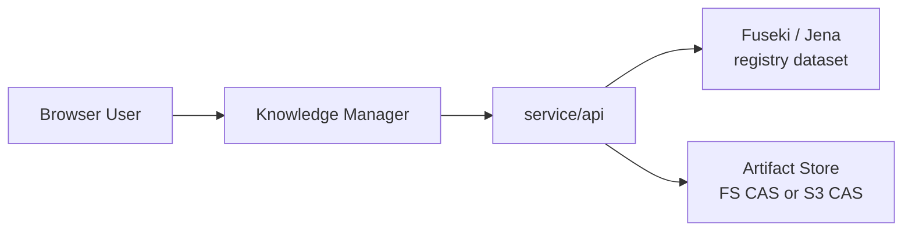

## `service/webapp/knowledge-manager` — Thin Registry Admin And Ontology Launchpad

This service is the first runnable human-facing surface for the repo.

It is intentionally thin:
- browse registry `agents` and `skills` through `service/api`
- inspect agent and skill detail pages
- register agents and skills through browser forms that proxy to `service/api`
- create new skill drafts through the lifecycle management-plane API
- operate skill lifecycle transitions from the browser: validate, publish, promote, deprecate, certify
- keep a minimal server-side management session so operators do not need to paste a bearer token into every form
- align browser session acquisition to the same `api_key` / `okta` / `dual` auth direction used by `service/api`
- expose a minimal Semantic Turkey / VocBench companion integration path
- deep-link users into VocBench for real ontology editing

It is **not** yet a full ontology/model/data authoring product.

### Known limits and deferred items
- real Okta-backed ontology access through the Semantic Turkey / VocBench companion is intentionally deferred
- the Okta browser work in this repo currently applies to the registry-admin surface over `service/api`, not to companion ontology-authoring access
- Semantic Turkey / VocBench still uses its own runtime/session model and remains a separate authority for ontology work
- browser sessions for registry-admin work are durable now, but that does not imply shared identity/session across the companion tooling

### Get value fast

```bash
cd cachet/service/webapp/knowledge-manager
npm install
npm run dev
```

Then open:

```text
http://localhost:3200
```

For local `api_key` mode, first mint an API key:

```bash
cd cachet/service/api
npm run create-api-key -- --owner-label "Jane Doe"
```

Then open the webapp, start a management session once with that bearer token, and use the registry-admin forms from there.

For internal-beta-like auth alignment:
- set the webapp auth env to mirror `service/api`
- preferred operator path is `AUTH_MODE=dual` or `AUTH_MODE=okta`
- in `OKTA_MODE=mock`, the webapp can start a mock Okta-backed session without manual token paste
- in `OKTA_MODE=real`, the webapp uses an Okta authorization-code + PKCE browser flow and then validates the access token through `service/api`

### Local env
Copy or create values from:

```text
service/webapp/knowledge-manager/infra/.env.example
```

Most important values:
- `API_ORIGIN=http://localhost:3100` for direct local service use
- `VOCBENCH_UI_URL=http://localhost:1979/vocbench3`
- `DATABASE_URL=file:./var/knowledge-manager.db` for direct local service use
- `AUTH_MODE=api_key|okta|dual`
- `OKTA_MODE=mock|real`
- `OKTA_REDIRECT_URI=http://localhost:3200/session/callback`
- `OKTA_SCOPES=openid profile email`
- `SESSION_COOKIE_NAME=knowledge_manager_session`
- `SESSION_TTL_MINUTES=480`
- optional `OKTA_ISSUER`, `OKTA_CLIENT_ID` for real Okta login
- optional `SEMANTIC_TURKEY_BASE_URL`, `SEMANTIC_TURKEY_EMAIL`, `SEMANTIC_TURKEY_PASSWORD`

### What it uses
- `service/api` as the canonical management-plane source for registry metadata
- Semantic Turkey Web API as an optional read-only companion path for ontology project visibility
- VocBench UI as the human editing authority for ontology authoring

### Metadata vs bytes



Current local default:
- metadata and relationships live in the local `json_file` graph state (Fuseki/SPARQL is the optional lane)
- artifact bytes live in the artifact store
- the webapp itself only talks to `service/api`

Useful follow-up doc:
- `docs/fuseki-query-pack.md`
- `docs/graph-ui-plan.md`

Current lightweight graph UI:
- `GET /graph`
- `GET /fuseki-queries`
- the graph page is a thin rooted visual explorer driven by `service/api`
- the Fuseki queries page is a copy-paste operator shortcut surface
- agent and skill detail pages now include contextual `View graph` links

### Current routes
- `GET /healthz`
- `GET /readyz`
- `GET /`
- `POST /session/login`
- `GET /session/callback`
- `POST /session/logout`
- `GET /agents`
- `GET /agents/new`
- `POST /agents/new`
- `GET /agents/:agentKey`
- `GET /skills`
- `GET /skills/new`
- `POST /skills/new`
- `GET /skills/:skillKey`
- `GET /graph`
- `POST /skills/:skillKey/drafts`
- `POST /skills/:skillKey/versions/:version/validate`
- `POST /skills/:skillKey/versions/:version/publish`
- `POST /skills/:skillKey/versions/:version/promote`
- `POST /skills/:skillKey/versions/:version/deprecate`
- `POST /skills/:skillKey/versions/:version/certify`
- `GET /ontology-projects`
- `GET /fuseki-queries`
- `GET /api/registry/agents`
- `GET /api/registry/skills`
- `GET /api/knowledge/ontology-projects`

### Important boundary
This webapp does **not** call `service/registry` directly.

It should:
- use `service/api` for registry management-plane views
- use `service/api` to validate the operator session principal and auth mode
- use Semantic Turkey / VocBench only for the knowledge-authoring companion path

### Durable session note
The knowledge-manager now persists browser sessions server-side in SQLite.

Default local-dev style path:
- direct local run: `DATABASE_URL=file:./var/knowledge-manager.db`
- compose path: `DATABASE_URL=file:/workspace/data/webapp/knowledge-manager.db`

Important:
- the DB stores server-side bearer/access tokens as an operator convenience cache
- this improves restart durability, but it is not a separate auth authority

### Live Okta proof
For a real Okta browser-flow exercise, see:
- `service/webapp/knowledge-manager/OKTA_BROWSER_FLOW_RUNBOOK.md`

That runbook is currently for the registry-admin surface only.

It is **not** a current operator path for Semantic Turkey / VocBench ontology access, which remains intentionally separate for now.

### Mock Okta browser demo
For the local first-user demo path, there is now a small browser automation script for the mock-Okta lane:

```bash
npx playwright install chromium
npm run demo:mock-okta
```

Default target:
- `WEBAPP_ORIGIN=http://localhost:3200`

This script proves:
- the mock-Okta login button is present
- a browser session is established
- the `agents` and `skills` pages are reachable
- logout works

### Test

```bash
npm run lint
npm run typecheck
npm test
```
