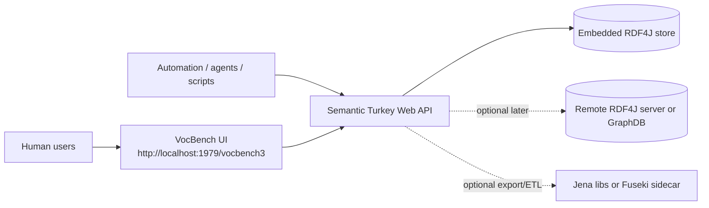

# VocBench + Semantic Turkey local dev guide

_Date:_ 2026-03-08  
_Audience:_ engineers and AI coding agents  
_Goal:_ get a local setup running fast for **human ontology authoring in VocBench** and **programmatic management through the Semantic Turkey API**.

## Scope boundary

This guide is intentionally about the companion ontology-authoring runtime.

For now:
- Semantic Turkey / VocBench remains a separate authority and session model
- it is not yet unified with the `service/api` / knowledge-manager Okta browser session work
- real Okta-backed ontology access is intentionally deferred in the current roadmap

Treat this guide as:
- the local operator path for the companion ontology runtime
- not as a statement that knowledge-manager and VocBench already share one identity boundary

## Executive recommendation

Use the **VocBench full distribution** first.

Why:

- It already bundles **Semantic Turkey** plus the **VocBench** web app.
- The official docs say the basic install is just: install **Java 17+**, unzip the package, run the `semanticturkey` script, then open `http://localhost:1979/vocbench3`.
- For quick local dev, the embedded RDF4J store is fine. For anything bigger or longer-lived, move to a remote **RDF4J server** or **GraphDB** later.

For your use case, the best shape is:

- **VocBench full distribution** = human editing UI + Semantic Turkey backend
- **Embedded RDF4J native store** = fastest first working setup
- **Optional later**: remote GraphDB or RDF4J server for more control
- **Optional Jena** = companion library / sidecar for ETL, export, validation, or app-specific query workflows; **not** the primary VocBench backing store

## What to avoid

Do **not** make Apache Jena / Fuseki the primary backing store for VocBench if you want VocBench/Semantic Turkey features like history/validation/remote-store support to behave as intended.

Semantic Turkey is now RDF4J-centric. Official docs say supported remote options are RDF4J-compatible stores, with RDF4J server and GraphDB explicitly listed. The FAQ also explains that the project moved away from older Jena-wrapper approaches and standardized on RDF4J.

The practical implication:

- **Good**: VocBench/Semantic Turkey as system of record, Jena in your application or sidecar pipeline
- **Bad**: trying to replace the RDF4J/GraphDB side of the stack with Fuseki as the authoritative VocBench backend

## Recommended architecture



## Repo layout to create

Use a layout like this inside your project:

```text
<project-root>/
  docs/
    VOCBENCH_SEMANTIC_TURKEY_LOCAL_DEV_GUIDE.md
  tools/
    vocbench/
      downloads/
      runtime/
      data/
  scripts/
    vocbench-download.sh
    vocbench-start.sh
  .gitignore
```

Suggested `.gitignore` additions:

```gitignore
tools/vocbench/downloads/
tools/vocbench/runtime/
tools/vocbench/data/
.cookies/
```

Notes:

- Keep **binaries and runtime data out of git**.
- `SemanticTurkeyData` will be created **next to** the Semantic Turkey install directory on first run, so make sure the install path is writable.
- On Windows, do **not** install directly under a write-protected root like `C:\`.

## Agent task list

### 1) Create directories

```bash
mkdir -p tools/vocbench/downloads tools/vocbench/runtime tools/vocbench/data scripts .cookies
```

### 2) Install Java 17+

Verify:

```bash
java -version
```

Expect Java 17 or newer.

### 3) Download the official package

Prefer the **VocBench full distribution**.

Official pages:

- VocBench docs: <https://vocbench.uniroma2.it/doc/>
- VocBench downloads page: <https://vocbench.uniroma2.it/downloads/>
- Bitbucket downloads page: <https://bitbucket.org/art-uniroma2/vocbench3/downloads/>

At the time this guide was written, the public official download snippets showed:

- `vocbench3-14.0.0-full.zip`
- `semanticturkey-14.0.zip`

Try this first from Bash:

```bash
curl -fL \
  -o tools/vocbench/downloads/vocbench3-14.0.0-full.zip \
  https://bitbucket.org/art-uniroma2/vocbench3/downloads/vocbench3-14.0.0-full.zip
```

If Bitbucket blocks CLI download in your environment, download manually from the official downloads page and place the file here:

```text
tools/vocbench/downloads/vocbench3-14.0.0-full.zip
```

### 4) Unzip into runtime

```bash
unzip -q tools/vocbench/downloads/vocbench3-14.0.0-full.zip -d tools/vocbench/runtime
```

Then locate the actual Semantic Turkey starter script:

```bash
find tools/vocbench/runtime -type f -path '*/bin/semanticturkey.sh'
```

You should see something like:

```text
tools/vocbench/runtime/.../semanticturkey-14.0/bin/semanticturkey.sh
```

### 5) Add a start script to the repo

Create `scripts/vocbench-start.sh`:

```bash
#!/usr/bin/env bash
set -euo pipefail

ROOT="$(cd "$(dirname "${BASH_SOURCE[0]}")/.." && pwd)"
RUNTIME_DIR="$ROOT/tools/vocbench/runtime"

ST_SCRIPT="$(find "$RUNTIME_DIR" -type f -path '*/bin/semanticturkey.sh' | head -n 1)"
if [[ -z "${ST_SCRIPT:-}" ]]; then
  echo "Could not find semanticturkey.sh under $RUNTIME_DIR"
  echo "Unzip the full VocBench distribution first."
  exit 1
fi

ST_HOME="$(cd "$(dirname "$ST_SCRIPT")/.." && pwd)"
mkdir -p "$ROOT/tools/vocbench/data"

echo "Using Semantic Turkey home: $ST_HOME"
cd "$ST_HOME/bin"
exec ./semanticturkey.sh
```

Make it executable:

```bash
chmod +x scripts/vocbench-start.sh
```

### 6) Start the stack

```bash
./scripts/vocbench-start.sh
```

Then open:

```text
http://localhost:1979/vocbench3
```

## First access flow

On first access, VocBench detects that no users exist yet and prompts registration for the first user, which is automatically promoted to administrator.

The UI also offers a **pre-defined dummy user** with email `admin@vocbench.com` for people who want to use VocBench like a desktop tool.

Recommended for real work:

- create your own admin user
- skip SMTP/email setup initially unless you need email verification or notifications
- keep the first setup minimal

## First project: fastest ontology setup

Create your first project through the UI before automating it.

Recommended initial settings for a normal ontology project:

- **Project name**: `my_ontology`
- **Base URI**: your canonical ontology namespace, e.g. `https://example.org/ontology#`
- **Model**: `OWL`
- **Lexicalization**: `RDFS`
- **History**: `false` for the first local-dev pass
- **Validation**: `false` for the first local-dev pass
- **Undo**: `true`
- **Trivial inference**: `false` initially unless you specifically need it
- **Repository location**: local
- **Repository type**: native

Why this setup:

- It minimizes moving parts.
- It gives you a persistent local store.
- It keeps project creation simple enough to verify the full UI and API loop fast.

If your work is heavily lexicalized and really centered on lexica, not just labels, prefer **OntoLex as both semantic model and lexicalization model**.

## Importing an existing ontology

The project creation UI supports preload from:

- local file
- URI
- dataset catalog

For a quick start, preload from a local Turtle / RDF/XML / JSON-LD file if you already have ontology data.

## Where the data lives

On first run, Semantic Turkey creates a data directory named something like:

```text
SemanticTurkeyData
```

This is created as a **sibling of the Semantic Turkey install directory**.

This directory holds governance and platform state such as:

- users
- project metadata
- system configuration
- plugin-related settings

Back it up before upgrades.

## Local config you may edit later

For Semantic Turkey versions 12+, the runtime is served through **Spring Boot** and most configuration lives in:

```text
<ST_HOME>/config/application.yml
```

Useful edits:

```yaml
# server.port: 1979
# server.servlet.context-path: /vb
# server.servlet.session.timeout: 60m

logging:
  file:
    name: log/semanticturkey.log
  threshold:
    console: error
```

For local dev, I would usually leave the default port alone until the first successful boot is complete.

## API usage strategy

### The important mental model

VocBench is the human-facing client. **Semantic Turkey is the API surface**.

Official docs say all VocBench functionalities can be invoked programmatically by using the Semantic Turkey Web API.

### Base service shape

The documented address structure is:

```text
http://<host>:<port>/semanticturkey/<groupId>/<artifactId>/<ClassName>/<methodName>?<parameters>
```

For core services, the docs show examples like:

```text
http://127.0.0.1:1979/semanticturkey/it.uniroma2.art.semanticturkey/st-core-services/Projects/listProjects
```

### Authentication example with curl

Set a base URL:

```bash
BASE="http://localhost:1979/semanticturkey/it.uniroma2.art.semanticturkey/st-core-services"
COOKIE_JAR=".cookies/vocbench.cookies.txt"
mkdir -p .cookies
```

#### Register the first user by API

Use this only on a fresh installation with no users yet:

```bash
curl -c "$COOKIE_JAR" -b "$COOKIE_JAR" -X POST \
  "$BASE/Users/registerUser" \
  -d "email=YOUR_ADMIN_EMAIL" \
  -d "password=YOUR_ADMIN_PASSWORD" \
  -d "givenName=YOUR_GIVEN_NAME" \
  -d "familyName=YOUR_FAMILY_NAME"
```

The first user created is automatically granted administrator role.

#### Log in

```bash
curl -c "$COOKIE_JAR" -b "$COOKIE_JAR" -X POST \
  "$BASE/Auth/login" \
  -d "email=YOUR_ADMIN_EMAIL" \
  -d "password=YOUR_ADMIN_PASSWORD" \
  -d "_spring_security_remember_me=false"
```

#### List projects

```bash
curl -c "$COOKIE_JAR" -b "$COOKIE_JAR" \
  "$BASE/Projects/listProjects"
```

### Project creation via API

Semantic Turkey documents the `Projects/createProject` endpoint and shows the parameter structure, but the payload is large enough that the cleanest implementation pattern is:

1. create one project manually in the UI
2. capture the browser network request
3. turn that into a repeatable script for your project

That approach is explicitly aligned with the official Web API docs, which recommend learning actual calls by inspecting the requests emitted by VocBench.

A starter template for a local project-creation request looks like this:

```bash
curl -c "$COOKIE_JAR" -b "$COOKIE_JAR" -X POST \
  "$BASE/Projects/createProject" \
  --data-urlencode 'consumer=SYSTEM' \
  --data-urlencode 'projectName=my_ontology' \
  --data-urlencode 'baseURI=https://example.org/ontology#' \
  --data-urlencode 'model=<OWL model URI>' \
  --data-urlencode 'lexicalizationModel=<RDFS lexicalization model URI>' \
  --data-urlencode 'historyEnabled=false' \
  --data-urlencode 'validationEnabled=false' \
  --data-urlencode 'repositoryAccess={"@type":"CreateLocal"}' \
  --data-urlencode 'coreRepoID=my_ontology_core' \
  --data-urlencode 'supportRepoID=my_ontology_support' \
  --data-urlencode 'coreRepoSailConfigurerSpecification={"factoryId":"it.uniroma2.art.semanticturkey.plugin.impls.repositoryimplconfigurer.PredefinedRepositoryImplConfigurerFactory","configType":"it.uniroma2.art.semanticturkey.plugin.impls.repositoryimplconfigurer.conf.RDF4JNativeSailConfigurerConfiguration","properties":{"forceSync":"false","tripleIndexes":"spoc, posc","directTypeInference":"false","rdfsInference":"false"}}' \
  --data-urlencode 'supportRepoSailConfigurerSpecification={"factoryId":"it.uniroma2.art.semanticturkey.plugin.impls.repositoryimplconfigurer.PredefinedRepositoryImplConfigurerFactory","configType":"it.uniroma2.art.semanticturkey.plugin.impls.repositoryimplconfigurer.conf.RDF4JNativeSailConfigurerConfiguration","properties":{"forceSync":"false","tripleIndexes":"spoc, posc","directTypeInference":"false","rdfsInference":"false"}}'
```

I recommend **not** hard-coding this until you have captured one successful request from your running version.

## API gotchas for automation

### 1) Learn endpoints from the browser first

The official docs explicitly say the easiest way to understand actual service calls is to use a client like VocBench and log browser requests while using the UI.

That is the right move for AI agents too.

### 2) HTTP 200 does not always mean success

VocBench’s developer docs explain that Semantic Turkey may return **HTTP 200 even for application-level exceptions**, with the error represented in the response payload.

So your automation must:

- parse the body
- detect exception payloads
- not rely on HTTP status code alone

### 3) Some services are GET, some are POST

The Web API docs explain that request method is derived from the Java service declaration. If a service is annotated with `@STServiceOperation(method = RequestMethod.POST)` it is POST; otherwise GET is the default.

If you are unsure, inspect the browser request first.

## When to move off the embedded store

Start with local/native embedded RDF4J.

Move to a remote store when one of these becomes true:

- you need fuller control of the data tier
- your dataset size is growing materially
- you want more operational separation
- multiple tools/services should share the same store

Officially supported remote directions are:

- RDF4J server
- GraphDB

## Remote store notes

If you later create projects against a remote store and enable advanced features like **history** or **validation**, the docs say you must deploy the Semantic Turkey sail components into the target triple store:

- `st-changetracking-sail-<version>.jar`
- `st-trivial-inference-sail-<version>.jar` (if using trivial inference)

For local-only development, ignore this for now.

## Jena guidance

### My recommendation

Add Jena only in one of these roles:

- **library in your own app** for RDF parsing/serialization/transforms
- **batch ETL tool** for imports/exports
- **SHACL / validation helper** in your application pipeline
- **Fuseki sidecar** as a read model or integration surface fed from VocBench-managed data

### Good pattern

```text
VocBench/ST = source of truth
      |
      +--> export TTL / RDFXML / JSON-LD --> Jena/Fuseki for app-specific workloads
```

### Bad pattern

```text
Fuseki as the authoritative VocBench backend
```

The stack is not designed around that path anymore.

## Optional: Semantic Turkey without VocBench

Only do this if you specifically want a **headless API-first deployment** or your own custom frontend.

Official Semantic Turkey standalone downloads exist separately, but for your use case the **VocBench full distribution is the shortest path** because it already includes the backend and the UI.

## Useful operational notes

### Logs

For ST 12+ the docs show logging configured in `config/application.yml`, with default file output like:

```text
log/semanticturkey.log
```

VocBench client-side issues are usually easiest to inspect in the browser console.

### Memory tuning

For larger data loads, the docs mention environment variables such as:

- `JAVA_MAX_MEM`
- `JAVA_MIN_MEM`
- `GDB_MAX_MEM`
- `GDB_MIN_MEM` (GraphDB only)

Do not tune these until you have a stable baseline setup.

### Upgrades

Before any upgrade:

- stop the stack
- back up `SemanticTurkeyData`
- replace the application distribution
- keep the data directory

## Definition of done

Your local setup is good when all of this is true:

- `java -version` reports 17+
- `./scripts/vocbench-start.sh` boots without fatal errors
- `http://localhost:1979/vocbench3` loads
- you can create the first admin user
- you can create and open `my_ontology`
- `Projects/listProjects` works through curl using a session cookie jar
- a restart preserves your project state

## What I would do next in your project

1. Land this guide in `docs/`.
2. Add the two Bash scripts exactly as shown.
3. Get one successful UI-created OWL project working on the embedded native store.
4. Capture the browser requests for `Auth/login`, `Projects/listProjects`, and `Projects/createProject`.
5. Turn those captured requests into repo-owned automation scripts.
6. Only after that, decide whether you want GraphDB/RDF4J remote storage or a Jena sidecar.

## Official references

- VocBench documentation: <https://vocbench.uniroma2.it/doc/>
- VocBench system administration manual: <https://vocbench.uniroma2.it/doc/sys/>
- VocBench user manual: <https://vocbench.uniroma2.it/doc/user/>
- VocBench first access (admin): <https://vocbench.uniroma2.it/doc/user/first_access_adm.jsf>
- Semantic Turkey system admin manual: <https://semanticturkey.uniroma2.it/doc/sys/>
- Semantic Turkey Web API: <https://semanticturkey.uniroma2.it/doc/user/web_api.jsf>
- Semantic Turkey first-access API guide: <https://semanticturkey.uniroma2.it/doc/user/first_access.jsf>
- Semantic Turkey FAQ: <https://semanticturkey.uniroma2.it/doc/faq/>
- VocBench downloads page: <https://vocbench.uniroma2.it/downloads/>
- VocBench Bitbucket downloads: <https://bitbucket.org/art-uniroma2/vocbench3/downloads/>
- Semantic Turkey Bitbucket downloads: <https://bitbucket.org/art-uniroma2/semantic-turkey/downloads/>
